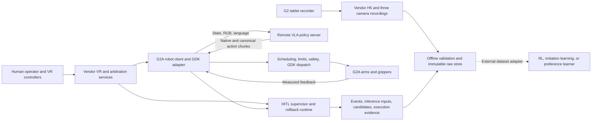

# VLA RL Data Collection

**Human-in-the-loop teleoperation, intervention collection, and VLA deployment for AGIBOT G2A.**

This project connects a dual-arm robot, the vendor VR/tablet teleoperation stack, a remote vision-language-action policy, trajectory rollback, and an auditable recording pipeline. Its purpose is to collect demonstrations, policy failures, human corrections, and execution evidence that can support imitation learning, actor-critic reinforcement learning, and preference-based VLA post-training.

The implemented platform is based on Nexus deployment code captured on **October 19, 2026**. This GitHub publication contains project source code, configuration, scripts, tests, and documentation. Third-party library source, installed dependencies, robot mesh binaries, model weights, tokenizers, recordings, and datasets are excluded. Dependency declarations and the project-specific LeRobot patch are retained for installation and provenance.

**Current implementation boundary:** robot execution, VR takeover, rollback, inference capture, recording binding, sidecar sealing, and offline archival are implemented. A project-specific raw-recording converter, G2 actor-critic training adapter, and FlowPRO preference optimizer still need to be integrated. The training sections below explain precisely how to connect the collected data to those learners; they do not claim an already connected end-to-end training loop.

## Contents

- [1. What the project provides](#1-what-the-project-provides)
- [2. Robot hardware and control dimensions](#2-robot-hardware-and-control-dimensions)
- [3. Observations, actions, and gripper conventions](#3-observations-actions-and-gripper-conventions)
- [4. System architecture and timing](#4-system-architecture-and-timing)
- [5. Repository layout](#5-repository-layout)
- [6. Installation and external prerequisites](#6-installation-and-external-prerequisites)
- [7. Teleoperation and collection procedure](#7-teleoperation-and-collection-procedure)
- [8. Exactly what gets recorded](#8-exactly-what-gets-recorded)
- [9. Sealing, transfer, and immutable archival](#9-sealing-transfer-and-immutable-archival)
- [10. Preparing a training dataset](#10-preparing-a-training-dataset)
- [11. Feeding data into actor-critic RL](#11-feeding-data-into-actor-critic-rl)
- [12. Training a VLA or another policy](#12-training-a-vla-or-another-policy)
- [13. FlowPRO-style preference learning](#13-flowpro-style-preference-learning)
- [14. Deploying an updated checkpoint](#14-deploying-an-updated-checkpoint)
- [15. Verification, limitations, and troubleshooting](#15-verification-limitations-and-troubleshooting)
- [16. Source provenance and licenses](#16-source-provenance-and-licenses)

For the full training specifications, read [Actor-Critic and Data Integration](docs/ACTOR_CRITIC_AND_DATA.md) and [VLA Training and Deployment](docs/VLA_TRAINING_AND_DEPLOYMENT.md).

## 1. What the project provides

The main use case is tabletop, dual-arm parcel manipulation with an existing policy and a human operator who can interrupt, rewind, restore the scene, and demonstrate a correction.

| Component | What is implemented | Training implication |
| --- | --- | --- |
| Workstation control | Model selection, task admission, runtime configuration, monitoring, and deployment management | Preserves the policy/runtime identity associated with a collection session |
| Remote VLA inference | G2-compatible pi0.5 server, observation processing, action-chunk generation, and model metadata | Captures the exact inputs and unnormalized native candidates |
| Robot client | Vendor GDK state/camera acquisition, action scheduling, execution, feedback, and safety integration | Separates predictions, issued commands, and measured movement |
| VR human takeover | Per-arm takeover requests with vendor arbitration evidence | Identifies human-controlled correction intervals |
| Trajectory rollback | Reverse traversal of measured execution history with anchored stopping | Supports returning to an earlier failure context |
| Tablet recording bridge | One fresh vendor recording bound to one collection episode | Keeps raw videos/H5 aligned with the corresponding sidecar |
| Durable sidecars | Event log, inference artifacts, candidate chunks, executed segments, hashes, and manifests | Preserves lineage needed for later dataset construction |
| Offline archive | SSH/rsync pull, validation, content-addressed storage, receipts, and acknowledgements | Creates a reproducible raw-data source for derived datasets |
| Actor-critic training | Integration design documented; no completed G2 training adapter in platform source | Requires explicit transitions, rewards, terminal semantics, and a learner |
| VLA fine-tuning | Existing model-serving integration; training requires an external library and converted dataset | Demonstrations and accepted corrections can become supervised examples |
| Preference post-training | Pair schema and validation are present | Pair extraction and the learning objective still require implementation |

The same recording can support several learning products, but each product needs its own quality rules. A valid physical recording does not automatically become a valid preference pair or a reward-labeled RL episode.

## 2. Robot hardware and control dimensions

### 2.1 Supported deployment target

The implemented hardware adapter targets **AGIBOT G2A**, using the vendor **`agibot_gdk`**. The deployment includes a head RGB camera, left wrist RGB camera, right wrist RGB camera, and profile-specific grippers. Camera manufacturer/model numbers and the exact VR headset model are not established by the supplied code.

The current gripper profile is **Dahuan / DH Robotics**, identified in configuration as `dahuan`. A separate `omnipicker_legacy` profile is also implemented. These profiles use different units and conventions and must not be mixed.

The main reference files are [constants.py](thor_project/src/nexus_deploy/robot/g2a/constants.py), [gdk_adapter.py](thor_project/src/nexus_deploy/robot/g2a/gdk_adapter.py), and [effector_profiles.py](thor_project/src/nexus_deploy/robot/g2a/effector_profiles.py).

### 2.2 Canonical 24-dimensional interface

The robot/network interface uses the following fixed order. Slices use Python's exclusive upper bound.

| Index / slice | Width | Coordinate names | Unit |
| --- | ---: | --- | --- |
| `0:7` | 7 | `left_arm_joint1` ... `left_arm_joint7` | rad |
| `7` | 1 | `left_effector_position` | Profile dependent; m for Dahuan |
| `8:15` | 7 | `right_arm_joint1` ... `right_arm_joint7` | rad |
| `15` | 1 | `right_effector_position` | Profile dependent; m for Dahuan |
| `16:19` | 3 | `head_joint1` ... `head_joint3` | rad |
| `19:24` | 5 | `waist_joint1` ... `waist_joint5` | rad |

This is **22 rotational coordinates plus two scalar end-effector coordinates** in the implemented interface. It is not a statement of every physical degree of freedom on the complete robot. Mobile-base motion is outside this vector.

The corresponding vendor body names are:

```text
Left arm:  idx21_arm_l_joint1 ... idx27_arm_l_joint7
Right arm: idx61_arm_r_joint1 ... idx67_arm_r_joint7
Head:      idx11_head_joint1 ... idx13_head_joint3
Waist:     idx01_body_joint1 ... idx05_body_joint5
Effectors: idx31_gripper_l_inner_joint1, idx71_gripper_r_inner_joint1
```

### 2.3 Native 16-dimensional policy interface

The common manipulation policy controls **14 arm joints and two gripper coordinates**:

```text
a16 = [left_arm_1 ... left_arm_7, left_gripper,
       right_arm_1 ... right_arm_7, right_gripper]
```

Native 16D policies use the first 16 canonical coordinates. The server/client conversion keeps the robot boundary at 24D and holds or restores head/waist coordinates according to the execution contract. A checkpoint can also declare a native 24D interface; loading validates dimensions and feature names.

Do not pad arbitrary actions with eight zeros. Zero is a physical joint target. Use the existing mapping and preserve the intended head/waist state.

## 3. Observations, actions, and gripper conventions

### 3.1 Policy inputs

| Input | Collection / protocol meaning | Typical training representation |
| --- | --- | --- |
| Canonical robot state | Exact measured `float32[24]` associated with the inference request | `observation.state`, often selected to 16D for the manipulation checkpoint |
| `cam_head` | Head RGB image | `observation.images.cam_head` |
| `cam_left_wrist` | Left wrist RGB image | `observation.images.cam_left_wrist` |
| `cam_right_wrist` | Right wrist RGB image | `observation.images.cam_right_wrist` |
| Task instruction | The language task supplied to inference | Dataset task text and model tokenizer output |
| Identity and timing | Session, request, observation, generation, and vendor timestamps | Provenance columns and join keys |

The adapter maps the three cameras to vendor head/left-hand/right-hand color streams. Wrist transport defaults use direct resizing to `640 x 400`; this is a transport setting, not a universal training image shape. Checkpoint preprocessing determines the final image size and normalization. The pi0.5 wrapper converts decoded HWC RGB images to CHW floating-point tensors before its processor pipeline.

The sidecar retains the exact JPEG inputs associated with inference anchors. A later converter must explicitly decide whether it is using those inference images or synchronized frames from the continuous vendor recordings.

### 3.2 Absolute, unnormalized action chunks

The external action contract is `absolute_unnormalized`:

```text
native candidate: float32[T, D], D in {16, 24}
canonical output: float32[T, 24]
T: checkpoint/session chunk size
```

These values are physical-space absolute targets after model-side postprocessing. A checkpoint may learn relative actions internally, but its processor must reconstruct the absolute targets expected by the robot interface.

There are three distinct signals:

1. **Policy candidate:** what the neural network predicted.
2. **Dispatched command:** what the scheduler, shaping, and safety pipeline actually sent.
3. **Measured state:** what feedback reports the robot physically reached.

They are not interchangeable training labels. In particular, an unexecuted future candidate does not establish an RL transition.

### 3.3 Dahuan gripper direction

The Dahuan range is `0.0 ... 0.025 m`, but observation and action directions differ:

| Value | Measured state coordinate | Model action / installed GDK command convention |
| --- | --- | --- |
| `0.000 m` | Closed | Open command |
| `0.025 m` | Open | Close command |

The controller converts the model action to its internal measured-coordinate target:

```python
internal_target_m = 0.025 - clip(model_action_m, 0.0, 0.025)
```

Internal filtering, tracking, and geometry checks use that measured-coordinate target. The installed GDK command conversion then maps back at dispatch. A data adapter must preserve these coordinate labels and avoid applying an extra inversion.

For human demonstrations, converting measured gripper opening into a model-action label may require this inversion. For a stored policy-native action, the conversion has already been defined by its action-space contract. Record the source of every action label.

The legacy Omnipicker profile instead uses radians in `[-0.785, 0.0]` with identity conversion. Do not apply Dahuan's metre-based conversion to it, or use legacy reset gripper values as Dahuan targets.

## 4. System architecture and timing



The workstation handles the control UI, policy serving, deployment configuration, and optional vision/alignment services. The robot-side process handles vendor integration, observation capture, action execution, ownership evidence, and HITL sidecars. The robot client does not need to load the VLA's Torch/Transformers model.

### 4.1 Different clocks and rates

| Quantity | Meaning |
| --- | --- |
| Model FPS | Time spacing represented by adjacent predicted actions |
| Execution FPS | Rate at which the runtime consumes policy action steps |
| Servo FPS | Frequency of low-level command/feedback execution; physical HITL rollback requires 100 Hz |
| Inference request rate | How often a new chunk is requested; affected by chunk horizon, latency, and replanning |
| Camera timestamps | Actual acquisition times used for image/state alignment |
| DDS tick | Runtime event coordination cadence; not the robot servo rate |

For example, a 30 Hz policy action stream can be scheduled through a 100 Hz servo loop. This does not create 100 independent camera-supervised examples per second. Resampling must preserve which information was actually observed.

Cross-stream joins use **vendor timestamps in nanoseconds**. Monotonic timestamps are process-local and must not be compared directly across machines. Sidecar manifests record the clock contract and relevant offset evidence. Camera/state skew is checked against a maximum of **40 ms**.

### 4.2 General runtime versus formal collection

General runtime configuration supports synchronous, asynchronous, and RTC-related deployment paths. That does not make them interchangeable for a formally frozen collection round.

The current **formal v1 collection contract** requires a native 16D arm/effector policy, asynchronous non-RTC inference, no head/waist control, rollback, immutable rollback plans, the defined X-release behavior, three cameras, verified scene restoration, executed-policy evidence, and zero queue underruns for strict pair eligibility. It also binds runtime/processor/checkpoint identities and shaping settings.

Without `--collection-manifest`, the HITL service treats sessions as pilot/debug data without a formal collection-round identity. See [collection_manifest.py](thor_project/src/nexus_deploy/robot/g2a/hitl/common/collection_manifest.py) and [service.py](thor_project/src/nexus_deploy/robot/g2a/hitl/g2_runtime/service.py).

## 5. Repository layout

```text
.
|-- README.md
|-- SOURCE_EXPORT.json                 # Hashes of original files retained in this source-only export
|-- THIRD_PARTY_NOTICES.md
|-- docs/
|   |-- ACTOR_CRITIC_AND_DATA.md
|   `-- VLA_TRAINING_AND_DEPLOYMENT.md
|-- deployment_templates/
`-- thor_project/
    |-- pyproject.toml                 # Python 3.12 project and optional dependency declarations
    |-- uv.lock
    |-- configs/                       # Site/model configuration
    |-- scripts/                       # Environment, deployment, and diagnostics
    |-- src/nexus_deploy/
    |   |-- control/                   # Workstation admission, tasks, and recording bridge
    |   |-- control_api.py
    |   |-- deployment.py
    |   |-- vla/pi05/                  # G2 pi0.5 serving and processing
    |   |-- robot/g2a/
    |   |   |-- client.py
    |   |   |-- gdk_adapter.py
    |   |   |-- effector_profiles.py
    |   |   |-- safety_layer.py
    |   |   `-- hitl/
    |   |       |-- common/            # Data contracts, sidecar writer, provenance
    |   |       |-- schemas/           # Manifest/event/preference-pair schemas
    |   |       |-- g2_runtime/        # Supervisor, DDS, takeover, rollback
    |   |       `-- offline/           # Pull, validate, archive
    |   |-- alignment/
    |   |-- vision/
    |   |-- static/                    # Browser interface source
    |   `-- viewer/                    # Viewer source and textual model descriptions
    |-- tests/
    |-- tools/
    |-- docs/                          # Original engineering and deployment records
    `-- third_party/lerobot/
        |-- README.md
        |-- requirements-5090.lock
        `-- pi05-deployment.patch      # Project patch only; upstream library is not included
```

`thor_project/src` is the development authority. The original archive also contained a historical robot bundle and a reconstructed current-source bundle; those duplicate trees are intentionally omitted from this code publication.

Original documents under `thor_project/docs` preserve historical context and their original language. This English README and the two English integration guides explain the publication's current scope. Older deployment documents can describe earlier paths, defaults, or assets.

## 6. Installation and external prerequisites

### 6.1 Platform requirements

- Linux on the deployment machines: the robot process uses POSIX facilities such as `fcntl` and Linux-oriented services.
- Python **3.12** for `nexus-deploy-platform` (`>=3.12,<3.13`).
- An AGIBOT G2A with the compatible vendor GDK, camera interfaces, VR services, and tablet recorder.
- A workstation with a compatible GPU/PyTorch environment for VLA inference or training.
- SSH and rsync for the provided offline transfer command.
- Separately acquired model checkpoint, tokenizer, and matching serialized processors/statistics.
- Separately acquired robot mesh resources when using asset-dependent safety, geometry, or viewer tools.

The Windows path used to prepare this repository is a source location, not the supported robot execution environment. No robot services are started by cloning it.

### 6.2 Inspect the source and install the core package

The following is a Linux development setup. Hardware services and VLA dependencies require the additional prerequisites above.

```bash
git clone https://github.com/SILVIO-ZHENG/VLA_RL_collect_data.git
cd VLA_RL_collect_data/thor_project

python3.12 -m venv .venv
.venv/bin/python -m pip install -e '.[server,client,dev]'

# Print supported command-line arguments without starting a robot task.
PYTHONPATH=src .venv/bin/python -m nexus_deploy.robot.g2a --help
```

The existing `scripts/build_runtime_env.sh` describes the broader uv-based runtime environment. `scripts/build_pi05_env.sh` describes a separate model environment. Read their platform/wheel assumptions before using them. The recorded deployment pinned Torch 2.11.0, Torchvision 0.26.0, Transformers 5.5.4, and PEFT 0.20.0; compatible CUDA and ARM64/x86_64 builds remain external requirements.

### 6.3 Important LeRobot reconstruction limitation

Third-party LeRobot code is intentionally **not uploaded**. The retained preparation script pins an upstream revision and applies the retained project patch. That recipe predates additional trained-RTC changes seen in the original October 19 archive.

Consequently, running the old preparation/build scripts does not establish that the exact archived RTC implementation has been reproduced. A compatible externally managed LeRobot revision or the separately retained original runtime source is needed for that behavior. Its provenance must be recorded and tested. Ordinary fine-tuning and newer upstream RTC training must also be evaluated against the actual version selected.

See the detailed [dependency and training notes](docs/VLA_TRAINING_AND_DEPLOYMENT.md). Do not silently replace the model environment with an unpinned upstream checkout.

### 6.4 Site configuration and robot bundles

Use `deploy.example.toml`, `alignment.example.toml`, and site configuration files as references. Machine-local `deploy.toml` and `alignment.toml` are excluded. Replace historical paths, addresses, robot identities, checkpoint locations, and calibration references with the installation's actual values.

The project provides a real standalone client bundle builder:

```bash
# From thor_project, after preparing a valid site configuration and required resources:
PYTHONPATH=src .venv/bin/python -m nexus_deploy.deployment \
  --config configs/thor.toml client bundle --robot g2a
```

The destination is controlled by the site configuration. The builder supplies deployment metadata; do not substitute a hand-copied folder for a formally identified runtime. Asset-dependent build or verification steps need the resources omitted from this source-only repository.

## 7. Teleoperation and collection procedure

### 7.1 Prepare the workstation and robot

1. Clear the work area, verify the physical emergency stop, and stop other tasks competing for GDK control.
2. In the control UI, verify robot identity/idle status and select manual workstation authority.
3. Complete any required reset. Applying a real execution configuration can itself trigger body/gripper reset motion.
4. Select the intended checkpoint, effector profile, inference mode, execution rate, and safety configuration.
5. Select real hardware execution and enable human-in-the-loop operation. Use duration `0` when collecting multiple parcels in one task.
6. Save/apply the configuration and wait for successful model preparation, admission, and reset checks.
7. Start the tablet recording only after the workstation explicitly indicates that the new recording is admitted.

Physical rollback admission requires the implemented execution settings, including 100 Hz servo, safety/runtime checks, and verified end-effector ownership handoff. A checked-in calibration is an installation-specific artifact; it does not certify a different workcell.

### 7.2 Start one episode

1. Finish any old tablet recording. Ensure that only the intended new recording becomes active.
2. Release X, Y, and the side takeover buttons.
3. Start collection on the **G2 tablet**. The recording bridge binds the fresh vendor episode and starts the robot task in **HOLD**.
4. Wait for acknowledged HOLD and active task status. Recording start does not automatically begin policy motion.
5. With a neutral controller frame received, press and release **Y once** to enable Policy.

The tablet owns the original recording lifecycle. Nexus observes/binds that recording and writes additional provenance; it is not a replacement video recorder.

### 7.3 Controller behavior

| Input | Behavior |
| --- | --- |
| Press/release Y from HOLD | Start Policy after the runtime accepts the gesture |
| Press Y during Policy | Return to HOLD |
| Left or right side takeover button | Request human authority for the corresponding arm |
| Upper/index trigger during human control | Operate the corresponding gripper through vendor teleoperation |
| Hold X | Stop Policy and request reverse traversal of executed history |
| Release X during active rollback | Continue on the same rollback plan to its selected earlier inference anchor, then HOLD |

**Releasing X during an active rollback does not mean an immediate stop in place.** A very short X press may stop Policy before a rollback plan is formed. Abnormal motion requires the physical emergency stop.

Side buttons express requested authority. Actual arm ownership comes from vendor arbitration evidence. Handback additionally requires released controls, cleared takeover state, settled feedback, and healthy/fresh runtime observations; releasing a button alone does not prove that Policy has resumed.

### 7.4 Correct a policy failure

When a policy action is unsuitable, interrupt Policy, return to an appropriate earlier anchor if rollback is admitted, and restore the relevant scene context. Then use vendor teleoperation to demonstrate the intended motion. The runtime records intervention, rollback, ownership, restoration, and correction events.

Robot joint similarity alone does not establish scene equivalence. If the object moved, slipped, changed contact, or became occluded, a later preference builder must verify that the correction still represents the same decision context.

### 7.5 Save and collect the next parcel

1. Stop and save the current episode on the tablet.
2. Wait for final vendor metadata/files and sidecar sealing.
3. Keep the Nexus task running if another parcel will be collected.
4. Start a new tablet recording; it receives a new episode binding and starts in HOLD.
5. Press/release Y again for that episode.
6. End the Nexus task only after the final recording is saved and its sidecar is sealed.

The original operator procedure is preserved in [HITL_TABLET_COLLECTION.md](thor_project/docs/robot/g2a/HITL_TABLET_COLLECTION.md).

## 8. Exactly what gets recorded

### 8.1 Vendor recording

```text
/data/record/<record_name>/
|-- meta_info.json
|-- record/aligned_joints.h5
`-- camera/
    |-- head_color/head_color.h265
    |-- head_color/head_color.txt
    |-- hand_left_color/hand_left_color.h265
    |-- hand_left_color/hand_left_color.txt
    |-- hand_right_color/hand_right_color.h265
    `-- hand_right_color/hand_right_color.txt
```

The H5 contains vendor-aligned joint/timestamp data. The text files supply camera timestamps. A converter must inspect the actual H5 schema and map vendor fields to the canonical joint convention; raw DDS/HAL encoder positions must not be assumed to be radians.

### 8.2 HITL sidecar

```text
/data/logs/flowpro_sidecar/<session_uuid>.sealed/
|-- manifest.json
|-- events.wal
|-- policy_candidates/<candidate_uuid>.f32
|-- inference_inputs/<observation_uuid>.state.f32
|-- inference_inputs/<camera artifacts>
`-- executed_segments/<intervention_uuid>/<execution artifacts>
```

During collection, the directory has an `.open` suffix and a partial manifest. A completed, validated session becomes `.sealed` with its final manifest.

The sidecar captures or references:

- Session, task, robot, observation, request, candidate, generation, intervention, and chunk identities.
- Checkpoint ID, normalization-statistics hash, processor version, effector profile, native action dimension, model FPS, and chunk size.
- Exact canonical inference state (`float32[24]`, 96 bytes) and exact inference JPEG artifacts.
- Native candidates (`float32[T,D]`) and content hashes.
- Ownership changes, VR evidence, plan installation, servo/safety events, rollback, restoration, and correction events.
- Frozen executed-history artifacts, including measured state, model actions, safety targets, GDK commands, acceptance/modification flags, timestamps, and lineage.

Execution-history artifacts are frozen around the implemented intervention workflow; do not assume that every session contains a dense, complete per-frame command log. A dataset builder must measure the available coverage and reject transitions whose action provenance is missing.

### 8.3 Schema references

| Contract | Source |
| --- | --- |
| Sidecar manifest | [sidecar-manifest-v1.schema.json](thor_project/src/nexus_deploy/robot/g2a/hitl/schemas/sidecar-manifest-v1.schema.json) |
| Events | [event-v1.schema.json](thor_project/src/nexus_deploy/robot/g2a/hitl/schemas/event-v1.schema.json) |
| Preference pairs | [preference-pair-v1.schema.json](thor_project/src/nexus_deploy/robot/g2a/hitl/schemas/preference-pair-v1.schema.json) |
| Formal collection round | [collection-manifest-v1.schema.json](thor_project/src/nexus_deploy/robot/g2a/hitl/schemas/collection-manifest-v1.schema.json) |
| Cross-field validation | [contract.py](thor_project/src/nexus_deploy/robot/g2a/hitl/common/contract.py) |
| Sidecar storage/sealing | [sidecar.py](thor_project/src/nexus_deploy/robot/g2a/hitl/common/sidecar.py) |

The data contracts support native 16D and 24D candidates and a positive selected model cadence. The stricter formal round contract narrows those choices further.

## 9. Sealing, transfer, and immutable archival

Sealing waits for the tablet to finish writing final metadata and files. It validates the bound recording, required streams, monotonically ordered timestamps, camera skew, event references, artifact sizes, and hashes.

Thor-side pull/archival is currently **a manual command for each sealed episode**; the UI does not provide an automatic archive button.

```bash
# Run on the Linux workstation, from thor_project.
# Replace SESSION_UUID with the .sealed directory's UUID, without the suffix.
PYTHONPATH=src .venv/bin/python -m nexus_deploy.robot.g2a.hitl.offline \
  SESSION_UUID \
  --ssh-target g2 \
  --remote-sidecar-root /data/logs/flowpro_sidecar \
  --remote-vendor-root /data/record \
  --staging-root runtime/thor/hitl-staging \
  --store-root runtime/thor/hitl-raw-store
```

Configure the `g2` SSH alias or replace it with the authorized target for the installation. The command uses noninteractive SSH and rsync, pulls both vendor recording and sidecar, verifies the manifest did not change during transfer, revalidates the bundle, and verifies the immutable archive receipt.

The archive uses content-addressed objects plus per-bundle metadata:

```text
hitl-raw-store/
|-- objects/<hash-prefix>/<sha256>
|-- receipts/<bundle_uuid>.json
`-- acks/<bundle_uuid>.json
```

Repeated ingestion of the same content is idempotent. A session identity with different content is rejected. This command retains the original G2 recording. The resulting store is a raw-data archive, not yet a LeRobot dataset or RL replay buffer.

## 10. Preparing a training dataset

The raw-to-training adapter is the main missing bridge. It should create versioned derivatives while retaining links back to immutable source objects.

### 10.1 Required conversion stages

1. Validate the source bundle and resolve its manifest, sidecar events, cameras, and H5 data.
2. Map actual vendor joint fields into the canonical coordinate order and units.
3. Join observations, camera frames, ownership, accepted commands, and measured execution using vendor timestamps and explicit lineage.
4. Select the learning cadence and action interface. Preserve actual time deltas and resampling decisions.
5. Split episodes/segments at resets, unrelated recordings, unverified scene restoration, and other discontinuities.
6. Distinguish policy, human, HOLD, rollback, and safety-modified intervals.
7. Construct supervised labels, RL transitions, or preference pairs according to separate eligibility rules.
8. Add independently defined task outcomes/rewards where required.
9. Compute statistics for the final representation and save provenance, masks, splits, and quality reports.
10. Decode random samples and replay targets offline before starting training.

### 10.2 Suggested supervised record

The following is a proposed derived format, not the raw sidecar's existing schema:

```text
episode_id, frame_index, vendor_timestamp_ns, task
observation.state                     float32[16] or float32[24]
observation.images.cam_head           RGB[H,W,3]
observation.images.cam_left_wrist     RGB[H,W,3]
observation.images.cam_right_wrist    RGB[H,W,3]
action                                float32[D], declared physical convention
action_is_valid                       bool
control_owner, action_source, safety_modified
source_bundle_id, observation_id, candidate_id, intervention_id
```

For chunk-based policies, derive `action[t:t+T]` and a valid-step mask. A future chunk tail beyond the episode boundary must be masked rather than presented as real demonstrated motion.

### 10.3 Suggested RL transition

```text
(observation_t, action_t, reward_t, observation_next,
 terminated, truncated, dt, bootstrap_mask,
 owner, action_source, safety_modified, provenance)
```

`action_t` must be the action for the control interface being modeled. If the MDP uses absolute commanded targets, use the accepted target with known semantics. Substituting a later measured position silently changes the modeled interface. If measured trajectories are intentionally used as demonstration labels, document that choice and associated tracking/lag limits.

The runtime can report `EpisodeOutcome="success"` when the external tablet recording successfully commits. That outcome carries recorder authority and **does not independently establish that the parcel task succeeded**. Task reward labels require explicit annotation or a validated task-success detector.

Split datasets by whole episode, collection session/day, scene, or object configuration. Randomly splitting adjacent frames allows near-identical images and overlapping action chunks to leak into validation.

## 11. Feeding data into actor-critic RL

Here, **AC means actor-critic**. The actor predicts robot actions; the critic estimates their expected return. Collection provides evidence for learning, while the missing dataset/environment adapter defines the actual learning problem.

### 11.1 Network inputs and outputs

A practical design for the 16D manipulation interface is:

```text
Three RGB encoders + proprioception encoder + optional language encoder
                                  |
                             fused feature z
                           /                 \
             Actor pi(a | z)                 Twin critics Q1(z,a), Q2(z,a)
             16D action distribution          Scalar expected returns
```

For an absolute-target actor, output bounds must be per-coordinate physical limits, with the Dahuan action direction preserved. A tanh distribution requires an explicit, invertible mapping between normalized actor coordinates and those physical action bounds.

With batch size `B`, a proposed learner batch could contain `state[B,16]`, three image tensors `[B,3,H,W]`, `action[B,16]`, `reward[B,1]`, `next_state[B,16]`, and masks `[B,1]`. A chunk actor instead needs a temporal action contract such as `[B,K,16]` and a return/discount definition for that whole interval.

These shapes describe an integration design. The platform does not currently instantiate this G2 learner.

### 11.2 Reward and terminal semantics

Define a task-specific reward before training. For example, a separately verified correct placement can produce a terminal success reward; a verified drop or failure can produce a failure label. Intervention counts, time, or safety events may be auxiliary costs if that is the declared objective.

Record label authority, reward version, and evidence. Do not treat tablet save, every Y press, a rollback request, or an unreviewed human segment as an automatic reward signal.

A true terminal event ends the task MDP. A time limit or communication cutoff may be a truncation and requires a declared bootstrap policy. An operator reset or scene repositioning must not create a fictitious transition between unrelated states.

### 11.3 Training progression

1. Build a behavior-cloning baseline from verified demonstrations and correction intervals.
2. Fit observation/action normalization only on the training split.
3. If using a fixed dataset, select an offline method with explicit treatment of distribution shift. [Implicit Q-Learning](https://arxiv.org/abs/2110.06169) is one possible external implementation choice; it is not supplied as a G2 pipeline here.
4. If using [Soft Actor-Critic](https://arxiv.org/abs/1801.01290), implement the compatible G2 environment/replay interface and validate its reward/action/termination behavior before supervised online trials.
5. Retain source tags and control-authority masks when mixing human demonstrations and policy data.
6. Save the actor, critics, target networks, optimizer state, normalization, reward version, dataset revision, and source provenance.
7. Evaluate held-out scenes and controlled rollouts before returning a new actor to collection.

A generic upstream RL library is an external dependency. Its presence in the original archive did not mean it was connected to this HITL runtime, and its code is excluded from this publication.

### 11.4 How AC improvement reaches a VLA

A small actor's weights do not convert directly into a pi0.5 or other VLA checkpoint. Their architectures and training objectives differ.

The useful bridge is data and supervision:

- Collect verified successful rollouts from the improved actor with synchronized RGB, state, task text, and executed actions.
- Convert accepted trajectories into the VLA's supervised dataset format.
- Optionally use a separately validated critic to select or weight candidate actions, retaining its uncertainty and action-support limitations.
- Fine-tune the VLA through its native objective, or implement a separate teacher-distillation/preference objective.

The detailed [actor-critic guide](docs/ACTOR_CRITIC_AND_DATA.md) specifies transition construction, SAC objectives, offline learning, masks, rewards, and the remaining adapters.

## 12. Training a VLA or another policy

### 12.1 Direct supervised fine-tuning

The shortest learning path uses accepted demonstrations and corrections directly:

```text
Verified raw episodes and sidecars
    -> external alignment/selection converter
    -> image + state + task + action dataset
    -> checkpoint-compatible preprocessing and statistics
    -> supervised VLA fine-tuning
    -> held-out evaluation
    -> G2 deployment adapter
```

A critic is optional for this path. Pi0.5 supervised fine-tuning uses its flow-matching action objective; it is a different training route from actor-critic RL. The current upstream [pi0.5 documentation](https://huggingface.co/docs/lerobot/main/en/pi05) provides model-level guidance, while this repository's checkpoint and deployment contracts determine G2 compatibility.

The platform does not include the raw-sidecar-to-LeRobot exporter. `tools/build_clean_training_dataset_20260923.py` is a historical cleaner for already-existing Parquet datasets and depends on external site tooling; it is not that missing exporter.

### 12.2 LeRobot dataset layout

A converter targeting the audited LeRobot API should produce its supported metadata, episode, Parquet, and video structure, rather than renaming the raw H5 files:

```text
converted_dataset/
|-- meta/info.json
|-- meta/stats.json
|-- meta/tasks.parquet
|-- meta/episodes/chunk-000/file-000.parquet
|-- data/chunk-000/file-000.parquet
`-- videos/observation.images.<camera>/chunk-000/file-000.mp4
```

The exact layout is version dependent. The externally selected library version must match the converter and trainer. Use its dataset writer API to create metadata and finalize episodes.

### 12.3 Example fine-tuning invocation

This is a **template** for an external compatible LeRobot environment **after** the missing converter has produced a valid dataset and a matching pretrained G2 checkpoint is available. It was not executed as part of publication.

```bash
python -m lerobot.scripts.lerobot_train \
  --policy.path=/absolute/path/to/compatible/pretrained_model \
  --policy.push_to_hub=false \
  --dataset.repo_id=local/g2_hitl \
  --dataset.root=/absolute/path/to/converted_dataset \
  --dataset.eval_split=0.1 \
  --batch_size=8 \
  --steps=10000 \
  --output_dir=outputs/train/g2_hitl_pi05 \
  --wandb.enable=false
```

Batch size and step count are illustrative, not validated G2 hyperparameters. Match camera keys, feature order, gripper convention, absolute/relative processing, action horizon, and serialized normalization to the checkpoint. Evaluate the resulting model on held-out episodes and scenes.

### 12.4 Other model families

| Model family | How collected data can help | Required integration |
| --- | --- | --- |
| pi0.5 / compatible VLA | Language-conditioned imitation and optional post-training | Matching model package, checkpoint processors, 16D/24D contract, and training dataset |
| ACT | Supervised action-chunk prediction | Image/state feature mapping, action horizon/masks, trainer, and serving adapter |
| Diffusion policy | Learning multimodal action sequences | Observation/action windows, normalization, diffusion trainer, and deployment timing |
| SmolVLA or another VLA | Smaller language-conditioned manipulation policy | Compatible robot features, task text, action processing, and model-serving wrapper |
| SAC / another AC actor | Reward-based control improvement | Explicit reward/termination semantics, replay adapter, environment, and evaluation |
| Preference learner | Compare failed policy behavior and verified correction | Same-context pairs, masks, reference policy, and a separately implemented objective |

The 5090 configuration also references an **external LingBot-VLA deployment project** that is not included. This is distinct from **LingBot-VA**, whose released video/action world-model schema is not a drop-in 16D G2 joint-action interface. Any such integration needs its own kinematics/action representation, camera order, temporal conditioning, normalization, and serving adapter.

## 13. FlowPRO-style preference learning

The project uses intervention and rollback concepts associated with [FlowPRO](https://arxiv.org/abs/2606.05468), whose paper describes reward-free preference post-training for flow-matching VLAs. This is a separate route from training explicit reward critics.

For this repository, the collection-side objective is to retain enough evidence to compare:

```text
same observation/scene anchor
    + rejected executed policy trajectory, with native-candidate lineage
    + verified preferred human correction
    + aligned action horizon and valid-step mask
    + event, checkpoint, processor, and scene provenance
```

The preference-pair schema includes `scene_verified`, `sensor_skew_ok`, `same_anchor`, preferred/rejected artifact metadata, valid masks, and provenance events. It recognizes measured corrections and other declared preferred sources, but those schema options are not an implementation of pair extraction or smooth interpolation.

Before marking a pair valid, establish that the failed policy behavior actually executed where required, rollback/restoration produced the intended context, camera timing is valid, and action coordinates/horizon agree. A queue-underrun hold may still be valid evidence for physical rewind while disqualifying strict preference training.

A complete training integration still needs pair extraction, context matching, masking, interpolation if used, reference-policy handling, the preference objective, and evaluation. The repository does not claim an official or complete reproduction of the FlowPRO learning algorithm.

## 14. Deploying an updated checkpoint

### 14.1 Preserve a complete model artifact

Keep a new immutable checkpoint/version directory with:

- Model weights and model configuration.
- Serialized observation/action processors and tokenizer references.
- Statistics and their hash, feature names, native dimensions, and effector profile.
- Training data revision, learning objective, reward/preference version if applicable, and code/environment identity.
- Model FPS, chunk size, and any supported RTC metadata.

Register it as a new model version rather than overwriting an existing checkpoint path.

### 14.2 Use the model registry and adapter

For pi0.5, add a version under the relevant effector variant in the site configuration. The following illustrates the existing TOML structure; choose installation-specific IDs and paths:

```toml
[models.pi05.effector_variants.dahuan.versions.my_g2_hitl_010000]
display_name = "G2 HITL fine-tune - step 10000"
normalization_source = "checkpoint_embedded"
normalization_label = "Embedded training statistics"
real_args = ["--checkpoint=/absolute/path/to/new/pretrained_model"]
```

Version arguments must satisfy the surrounding configuration's inheritance rules. Retain the intended tokenizer, processor, and effector settings. The checked-in Thor configuration currently selects `newdata_training_rtc_004500`; it is a historical configured default, not a checkpoint distributed by this repository or a claim that it is available on a newly installed machine.

An ordinary SFT checkpoint does not gain trained-RTC support by adding a command-line flag. The original archived model source had trained-RTC inference extensions, while its training forward did not wire in the corresponding prefix-training helper. A new trained-RTC checkpoint requires a compatible training implementation and validated metadata.

### 14.3 Acceptance sequence

1. Inspect checkpoint/processor metadata and compare feature names, dimensions, units, and action direction.
2. Run offline inference on known recorded observations; reject nonfinite or out-of-contract actions.
3. Check normalization and relative-to-absolute reconstruction with known targets.
4. Review command trajectories, timing, saturation, gripper behavior, and required geometry resources.
5. Start the selected server and confirm loading/warmup using the prepared model environment.
6. Validate the robot/client handshake and observations in the appropriate non-executing generic client mode.
7. Perform controlled on-site motion acceptance, then HITL collection with the new version recorded in provenance.

The generic robot client supports dry-run/read-only/execute modes. The composed production HITL service requires execution mode and starts in acknowledged HOLD; it is not an offline simulator. The included offline simulator is primarily an inspection/replay tool, not a demonstrated contact-accurate RL environment.

## 15. Verification, limitations, and troubleshooting

### 15.1 Source and test verification

[SOURCE_EXPORT.json](SOURCE_EXPORT.json) records the byte sizes and SHA-256 hashes of the original files retained in this publication. It is a **filtered source-export manifest**, not the original full-archive manifest. Newly written publication documentation is outside that original-file capture list.

For a prepared Linux development environment, relevant existing offline tests include:

```bash
cd thor_project
PYTHONPATH=src .venv/bin/python -m pytest -q \
  tests/test_hitl_contract.py \
  tests/test_hitl_sidecar.py \
  tests/test_hitl_g2_dds.py \
  tests/test_hitl_runtime.py \
  tests/test_hitl_service.py \
  tests/test_hitl_dispatch_ledger.py
```

Some suites require external dependencies or geometry resources excluded from the code-only publication. Tests using synthetic data do not establish successful physical robot operation.

During publication on Windows, the DDS and tablet-start suites produced **33 passes and one platform-specific failure**: Windows `select` cannot monitor the subprocess pipe used by the Linux tablet bridge. The dispatch-ledger suite could not collect because the robot process imports POSIX `fcntl`. These results are environment limitations, not a claim of a completed Linux/GPU/hardware validation.

### 15.2 Common blockers

| Symptom | What to inspect |
| --- | --- |
| More than one active tablet recording | Finish the extra recording and start one uniquely identifiable fresh episode |
| Tablet recording started, but no HOLD acknowledgement | Check task admission, recorder identity, G2 connection, and runtime logs before enabling Policy |
| Y has no effect after startup/reconnection | Release controls and wait for a neutral/fresh controller frame; inspect admission/ownership status |
| Released takeover button, but Policy does not resume | Check actual vendor authority, settled feedback, health, and handback gates |
| Rollback is rejected | Inspect execution evidence, timing gaps, required settings, ownership, safety admission, and anchor eligibility |
| Sealing fails | Check final vendor metadata, stream completeness, timestamp order, camera skew, hashes, and event references |
| Raw store exists but trainer cannot load it | Implement the conversion step; raw archive objects are not trainer-ready dataset shards |
| Grippers move in the opposite direction | Verify observation/action conventions and the exact point at which profile conversion occurs |
| Mesh or model asset missing | Acquire the matching external resources and preserve source/version/hash records |
| Old pi0.5 verification script rejects the source | Check the retained recipe's revision/patch assumptions and the RTC reconstruction limitation |
| Checkpoint shape or normalization mismatch | Compare native dimensions, canonical names, effector profile, camera features, and processors |

### 15.3 Remaining integration work

- Implement a versioned raw H5/video/sidecar converter with timing, ownership, action-provenance, and discontinuity handling.
- Provide explicit task outcome/reward annotation and evaluation specifications.
- Implement the G2 RL dataset/environment bridge and timeout-aware replay semantics.
- Implement strict preference-pair construction and the desired learning objective.
- Reconcile and pin the external model runtime/training source needed for the selected RTC behavior.
- Restore and validate required external robot/model resources before asset-dependent operations.
- Complete Linux/GPU checks and on-site execution acceptance for each deployment configuration.

## 16. Source provenance and licenses

This source-only export preserves retained original code bytes from `teleoperation_HITL_FlowPRO_20261019`; publication documentation was added on October 21, 2026. The original project archive remains the reference for omitted dependency snapshots and historical deployment bundles.

The repository's existing root license is [Apache-2.0](LICENSE). Retained third-party-derived assets and notices keep their own applicable licenses. In particular, AGIBOT Genie Sim robot descriptions/geometry references carry **MPL-2.0** notices. See [THIRD_PARTY_NOTICES.md](THIRD_PARTY_NOTICES.md) and the original license/source files next to the retained robot descriptions.

Third-party frameworks, vendor SDKs, external model checkpoints, tokenizers, and robot resources must be acquired separately under their own terms. None are made available merely by a reference in a site configuration.
