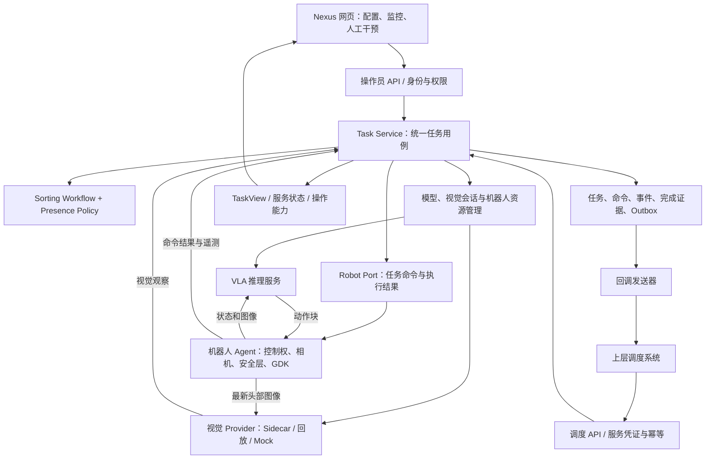

# Nexus 整体架构设计

状态：设计提案，2026-09-24。基于统一候选源码 `ef6bc36` 核对；本文中的目标接口、页面、数据库及控制权机制尚未实现。本文不意味着服务已上线或通过真机验收。

## 1. 核心决定

保留一个 `nexus_deploy` 仓库、一个任务编排后端，以及独立的 VLA、视觉和机器人运行进程。Nexus 网页与上层调度系统是同一个任务服务的两个入口。任务状态、配置版本和完成证据由后端持有；关闭浏览器不影响任务。

用户已确认的产品定位：机器人端或边缘设备上的模型部署与任务执行平台。Nexus 内绝对不实现业务任务队列；业务任务的排序、优先级、等待和重新调度全部归上层。当前/历史任务记录用于执行跟踪，不是待执行列表。

### 已确认：两种互斥的操作模式

| 规则 | 调试模式 `debug` | 自动运行模式 `automatic` |
|---|---|---|
| 新任务启动入口 | 操作员界面，经操作员 API | 上层调度 API |
| 另一入口发来的启动请求 | 拒绝调度启动 | 拒绝界面直接启动，包括旧 start 接口 |
| 界面用途 | 配置、调试、监控、人工控制 | 部署管理、监控、经授权的暂停/终止 |
| 参数变更 | 空闲时验证并应用 | 当前批次冻结；新版本空闲时激活 |
| 人工暂停 | 必须显式恢复 | 不允许视觉或重复调度请求自动恢复 |

操作模式与 `mock/replay/read-only/execute` 验证/硬件运行方式是两个独立维度。调试模式可经授权执行真机；只读不意味着拥有真机启动权，自动模式也不意味着立即运动。

模式切换要求没有活动任务、没有待确认的停止或复位命令、机器人已确认空闲。模式切换与任务准入由同一后端串行校验，避免同时发生时两个入口都成功。界面隐藏按钮仅用于表达规则，后端才是规则执行点。

### 已确认：无业务排队的准入规则

每台机器人最多有一个已接受、尚未完全结束的任务，包括 starting、running、paused、resetting、stopping 和 recovery_required。调度只能调用已部署就绪的方案；模型加载与方案激活属于部署阶段。

1. 先校验身份和 request_id 幂等：对已接受请求的相同参数重试返回原任务，不重复执行；冲突参数拒绝。
2. 对新请求，原子检查模式、接单开关、方案就绪状态及机器人空闲状态，并占用执行名额。
3. 通过即持久化任务并开始本次执行；HTTP 202 只表示已接受执行、结果异步产生，绝不表示进入业务等待队列。
4. 忙、模式不匹配、未就绪或停止接单时立即拒绝，并返回稳定原因码，如 ROBOT_BUSY、MODE_CONFLICT、NOT_READY、NOT_ACCEPTING。被拒绝请求不创建待执行任务，不会在空闲后自动补执行；允许保留拒绝审计。
5. 执行结束后释放名额，等待上层发起新的调用，不自动取下一批。请求响应丢失时，上层用同一 request_id 核实原任务。

接单开关只控制新的请求。关闭接单不自动终止当前任务；终止是独立操作。完成回调重试记录可以持久化，但只负责发送已有结果，绝不能驱动机器人或重新执行业务任务。

采用模块化后端：身份认证、任务用例、纯状态机、资源管理、持久化、外部适配器分层；初期运行在一个后端进程中。GPU 模型独立进程运行，GDK 和动作安全检查保留在机器人端。后端模块之间先使用类型明确的调用和事件，不引入消息中间件。

5090 用于开发、录像回放和集成验证；Thor 用于目标平台验证和现场运行。两台机器使用相同提交与协议版本，通过配置选择解释器、模型和地址。每台机器人同一时刻只有一个控制后端。

## 2. 当前实现与 Nexus 界面的关系

| 当前组件 | 已有职责 | 与界面的关系 / 待拆分点 |
|---|---|---|
| `src/nexus_deploy/static/index.html`、`app.js` | 按机器人、夹爪、模型、版本选择，探测、校验、创建部署 | 版本来自后端白名单；当前入口主要是准备模型，不等同于创建一个分拣批次 |
| `src/nexus_deploy/static/session.html`、`session.js` | 保存参数、开始/暂停/恢复/结束、复位、关闭模型、相机和三维显示 | 轮询 deployment 与 telemetry；按钮可用性仍主要由页面根据旧状态推导 |
| `src/nexus_deploy/control_api.py` | 网页 API、任务与模型管理、视觉子进程、状态机调用、机器人命令、状态持久化 | 公共准入和适配器已抽入 `control/`，既有工作流仍由 `ControlPlane` 编排 |
| `src/nexus_deploy/sorting_api.py` | HTTP 批次提交、request_id 去重、查询、可选回调 | 与界面入口共用 `TaskService` 准入 |
| `src/nexus_deploy/presence_gate.py` | 纯视觉门控：提出暂停、恢复、复位建议 | 领域策略，不访问模型、GDK、网络 |
| `src/nexus_deploy/vision/parcel/` | YOLO、规则、四帧确认和 HTTP 观察上报 | 计算独立；真实、回放和 Mock 通过适配器接入 |
| `src/nexus_deploy/robot/g2a/` | 相机、VLA 通信、动作执行、安全校验、遥测、视觉帧发布 | 唯一的应用层 GDK 所有者；视觉不能再开一份相机连接 |

现有 UI 调用 `/api/bootstrap`、`/api/validate`、`/api/deployments`，再通过 `/api/deployments/{id}/start|pause|resume|stop|configure|reset-robot|close-model` 操作会话。状态从 deployment、control-telemetry、camera 接口读取；三维视图通过独立 viewer 展示。

调度接口通过 `/api/sorting/tasks` 创建同一后端管理的作业。当前 task_id 与 deployment job id 共用同一个 ID；batch、task_session、robot_reset 等状态嵌在 DeploymentJob 内，存在多种状态映射。旧页面的 `succeeded` 不能直接解释成“本批物理分拣完成”。普通界面任务的空场复位后可以等待下一轮，调度批次则在复位成功后结束。

当前控制服务会使用本机 Python 启动视觉进程，并限制视觉 ingress 与 control URL 的主机关系；尚未提供可任意跨主机部署的 Vision Provider 管理接口。

## 3. 目标架构

图中多数后端方框是代码模块，不要求各启动一个服务。模型与视觉可以部署在控制主机本机；独立进程并不要求独立电脑。

界面通常只访问 Nexus 后端；三维渲染和图像通道可通过同一入口代理。浏览器不持有机器人凭证或视觉写入凭证，不直接控制推理或视觉服务。部署探测、软件安装和人工清理属于管理用例，不进入每帧推理通路。

## 4. 三条链路与模块边界

### 任务链路

部署阶段：界面配置 → 模型加载与方案验证 → 发布并激活方案 → 就绪。任务阶段：当前模式允许的启动入口 → 认证与幂等 → 原子准入并占用执行名额 → 固定配置快照 → 获得机器人控制权 → 初始化本批视觉/机器人会话 → 启动执行 → 任务状态事件。

界面调试与自动批次共享 workflow 和执行适配器，但启动权由模式互斥。人工调试会话显式标识为 `manual_session`，不能冒充调度生产批次或发送生产完成回调。自动模式下生产新任务只能由调度接口创建。

### VLA 动作链路

机器人观测 → VLA → 动作块 → 机器人端校验当前会话和安全约束 → 执行。

动作块不绕经网页、数据库或 HTTP 任务编排循环。机器人端高频安全检查与动作执行保持本地运行，避免后端或界面响应时间影响伺服。

### 视觉与完成链路

机器人观测流 → 最新头部帧 → 视觉推理与区域/时序规则 → PresenceObservation → Presence Policy → 控制意图 → Workflow 审核 → Robot Port → 带关联 ID 的执行结果 → Workflow 持久化完成与回调事件。

相机采集和视觉帧发布不能依赖 VLA 请求是否成功、是否持续产生动作；暂停期间需要继续提供画面。第一阶段在现有机器人 Agent 内拆分观测、推理和执行职责，继续保持单一 GDK 所有者。不要为视觉再启动独立的 GDK 相机进程。

| 模块 | 输入 | 输出 | 权限边界 |
|---|---|---|---|
| Task Service | 用户/调度命令、观察、执行结果 | 状态事件和适配器调用 | 唯一任务状态写入入口 |
| Workflow | 当前任务状态和事件 | 状态迁移、命令意图 | 纯逻辑，不访问网络/GDK |
| Presence Policy | 已验证的视觉证据、任务状态、时钟事件 | 暂停/恢复/复位建议 | 不直接执行 |
| Vision Provider | 帧与视觉会话配置 | 区域状态、聚合状态、健康状态 | 无机器人命令权限 |
| Policy Provider | 观测、语言任务与推理配置 | 动作块 | 不能绕过机器人安全层 |
| Robot Port | pause/resume/stop/reset 意图 | 接受、执行中、成功、失败、结果未知 | 统一命令接口；适配现有传输 |
| Robot Agent | 当前控制权、命令和动作块 | 执行、命令回执、遥测 | 最终拒绝旧控制者、旧任务和不安全动作 |
| Notifier | 已持久化的通知事件 | 交付状态 | 不修改任务结果，不驱动机器人 |

## 5. 必须区分的对象与生命周期

| 对象 | 生命周期 | ID / 版本 |
|---|---|---|
| RuntimeService | 模型或视觉服务进程，可跨批次复用 | service_id、模型摘要、健康状态 |
| Task | 一次明确的分拣批次 | task_id、来源、request_id、profile_revision、状态版本 |
| RobotSession | 批次的一次机器人连接/运行代次 | session_id、generation、controller_epoch |
| VisionSession | 某任务对应的时序缓存、ROI 与帧订阅 | vision_session_id、generation、stream_epoch |
| Command | 一次可追踪的暂停/复位等操作 | command_id、task_id、generation、deadline |
| Event | 一条任务、命令或健康事实 | event_id、task_id、revision、type、occurred_at |

完成 Task 后释放的是任务占用和会话，不必每批卸载模型。模型服务可选择 `keep_warm` 或 `unload_when_idle`；由资源管理器根据各机内存策略执行。视觉模型可先继续每任务 Sidecar，接口稳定后再换为常驻模型加隔离会话。

每个 VisionSession 都独立维护四帧窗口和规则状态；换任务、换 generation、换视角配置、断流或重启后必须重置。常驻模型不意味着跨批次共享历史。

## 6. Nexus 界面设计

以现有首页和 session 页面为基础，逐步形成以下视图，不要求立即重写前端。

已实现的页面入口规则（2026-09-28）：`/index.html` 准备机器人、夹爪、模型和版本，`/session.html?id=...` 保存并应用运行配置及选择手动／自动，`/monitor?id=...` 监控相机、机器人实测状态、碰撞信息和当前任务，`/history.html` 只查看已结束任务。界面不展示旧方案或独立的方案切换列表；后端保留当前部署指针与配置快照，以便在机器人空闲且预检通过时安全替换，忙时直接拒绝，不保存待执行任务。应用失败保持接单暂停，不把旧模型视作自动恢复。根地址优先显示活动／待核实任务，其次是当前部署；没有部署则在监控页显示配置引导。监控页保留按权限允许的当前任务控制，参数编辑只在运行设置。进入或恢复自动要求调度模板匹配当前配置、通过校验且模型健康；每次任务提交仍独立检查。模式切换保留已有的新任务暂停及其原因，不隐式恢复。

| 页面 | 用户关心的信息 | 操作及后端模块 |
|---|---|---|
| 工作站总览 | 当前机器人被谁占用、当前任务、VLA/视觉/机器人是否就绪 | 查看任务、服务健康；资源管理与 TaskView |
| 任务模板 | prompt、模型、机器人、视觉 profile、完成规则、安全配置版本 | 保存/校验/发布新版本；配置管理 |
| 任务控制台 | 任务来源、批次进度、相机/三维、视觉证据、命令结果 | 经权限校验的开始、暂停、恢复、结束；Task Service |
| 视觉诊断 | 对齐的源帧与掩码、ROI、各区域状态、帧龄、空场计时、模型/规则版本 | 录像回放、查看拒判原因；Vision diagnostics |
| 历史与通知 | 完成证据、人工干预、失败原因、回调待交付/已交付 | 按事件追踪；TaskStore 与 Outbox |

控制台显示手动／自动启动方式、停止接收新任务／核实后允许新任务操作及不可接收原因；此操作只控制下一次任务准入，不暂停当前任务。自动模式显示“等待调度”或当前批次，不提供人工新任务启动按钮。任务状态、各服务健康、回调交付状态分别显示。例如“任务完成 / 模型仍就绪 / 回调重试中”是合法组合。任务列表仅包含当前和历史任务，不出现业务排队列表或优先级编辑。

VLA 输入画面与视觉判定画面要显示各自 sequence、时间戳和用途；叠加图必须匹配同一帧，不能把旧掩码贴在最新相机帧上。没有诊断图时显示事实状态，不虚构叠加层。

后端返回 `allowed_actions` 及不可用原因，前端据此展示按钮；所有命令到达后仍再次校验当前状态与 `expected_revision`。过期页面发来的操作返回冲突并刷新。按钮禁用不是权限控制。

调度批次在页面上显示来源和 request_id。操作员可以依权限暂停/结束正在运行的调度任务；该干预进入同一任务事件流并反馈调度。人工暂停不会被视觉自动恢复；取消必须等待机器人停止结果，结果不明时进入 recovery_required。

生产批次运行期间冻结配置。ROI、模型、安全策略和完成阈值的修改生成新版本，供下一批选择。调试功能作为显式的人工会话入口。

浏览器轮询可继续使用；任务进度后续可改 SSE，携带事件游标用于重连。浏览器关闭、刷新、断线均不影响后台任务。高清帧、稠密遥测与低频任务事件使用不同通道和刷新速率。

## 7. 接口契约（目标，未实现）

保留现有 `/api/sorting/tasks` 对外接口，内部逐步转调 Task Service；现有 `/api/deployments/...` 作为兼容适配层。避免同时维护两套任务状态。

建议新增后端读取/管理接口：

| 接口 | 用途 |
|---|---|
| `GET /api/tasks`、`GET /api/tasks/{id}` | 网页任务列表与统一 TaskView |
| `POST /api/tasks` | 仅调试模式下，操作员以固定 profile 创建调试任务 |
| `POST /api/tasks/{id}/commands` | 带 command_id、expected_revision 的操作员命令 |
| `GET /api/tasks/{id}/events` | 事件历史；后续支持 SSE 和游标 |
| `GET /api/runtime-services` | 模型、视觉、机器人端服务健康 |
| `GET /api/profiles` | profile 及其已发布版本 |
| `POST /internal/vision/observations` | 仅限视觉会话凭证的观察上报 |
| `POST /internal/robot/command-results` | 仅限机器人会话的命令结果 |

请求使用 operator / scheduler / vision / robot 不同身份；CSRF 防护不替代操作员认证，调度 Bearer token 不进入浏览器。初期可以由同一 HTTP 服务暴露不同路由，但需分别验证权限。

契约公共字段：`schema_version`、`task_id`、`session_id`、`generation`、`sequence` 或 `command_id`。控制权相关请求另带 `controller_epoch`。观察增加 `stream_epoch`、采集时间、接收/推理时间、模型/规则/ROI 版本、有效性和拒判原因。

PresenceObservation 保留聚合状态并增加区域级证据。区域 `EMPTY`、`OCCUPIED`、`UNKNOWN` 必须由实际规则生成，未评估的区域不能填 EMPTY。当前四帧规则放在一个版本化 evidence profile 中，控制端验证 profile 与证据，而不把某个模型的所有内部字段写死在 HTTP handler。

同一机器时钟用 monotonic 计时；跨主机不得直接相减 monotonic。当前 Sidecar 接收时间不是相机采集时间。跨机器时间同步有可验证误差上限时才能计算端到端帧龄，否则按序号、流心跳、接收间隔与各阶段本地耗时进行保守判定；无法确认新鲜度时拒绝完成。

## 8. 工作流、故障和完成证据

方案 ready 属于部署服务生命周期。自动批次准入成功后进入 `starting → running → pausing → paused → resetting → completed`；starting 包含已占用执行名额后的本批会话初始化，不等待另一批结束。任务状态不设业务 queued 或 waiting_for_resource。调试模式由操作员显式启动，自动模式由已授权的调度调用启动。

| 事件 | 处理原则 |
|---|---|
| 连续有效空场不足门槛 | 保持观察，不触发完成 |
| 连续空场达到 1.5 秒 | 申请暂停，等待匹配的机器人回执 |
| 同一次空场达到 5 秒且已由视觉成功暂停 | 再次校验证据和所有权后申请复位 |
| 空场确认中出现有包裹、UNKNOWN、断流或序列断代 | 清空连续证据，重新确认；不能把断流时间算空场 |
| 人工暂停 | 记录 operator 原因；自动策略无权恢复 |
| 手动结束 | stopping；收到机器人停止结果后 cancelled，不是 completed |
| 暂停/复位回执超时或服务重启 | recovery_required；不盲目重发动作，不宣布成功 |
| 复位明确失败 | failed，并保留机器人占用直到停止状态确认 |
| 正常复位成功 | 检查对应 task/generation/command 及有效完成证据，再提交 completed |
| 回调失败 | 任务状态保持；独立重试通知 |

复位期间出现新包裹或视觉丢失，应记录冲突。机器人正在进行的复位按已批准的安全过程处理；不能因为收到复位成功就掩盖冲突而宣布本批完成。进入待核实状态或重新确认的策略需在现场流程中验证，禁止自动开始下一批。

当前代码对 stale/进程退出的部分处理侧重 UI 标记；显示“计时清除”不等于纯状态机的计时确已清除。改造应增加独立于 GET/网页轮询的健康检查与 ClockTick 事件，并验证长时间断流后的第一帧不会跨过空场门槛。当前 `UNKNOWN` 本身也不等于机器人已暂停。

建议将感知失联与空场策略分开：短暂 UNKNOWN 不触发空场动作；持续视觉故障由单独的健康策略提出受控暂停。阈值需结合延迟测量现场确定，不在本次设计中暗改当前行为。任何失联都禁止生成完成结果。

完成证据至少包含：task/profile 版本、四个区域证据、观测窗口、空场起止、图像新鲜度、匹配的暂停与复位回执、人工干预及模型/规则版本。继续明确记录没有独立传送带到达确认；视觉漏检、掉落、遮挡仍属于现场验收范围。

## 9. 状态存储、回调和控制权

第一阶段建议本机 SQLite 保存 tasks、sessions、commands、events、outbox 和 profile revisions；一台控制后端独占写入，避免共享网络目录数据库。任务状态迁移、事件和回调 outbox 在同一事务内提交。图片和视频不写入任务数据库，只保存诊断引用和摘要；高频遥测按另行的保留策略存放。

request_id 按调用身份/工作站划定唯一性范围，相同有效参数重试返回相同任务。command_id 用于命令去重和回执关联；不能由此承诺物理动作恰好执行一次。结果未知时查询/核实，而不是无限重发复位。

Notifier 使用稳定 event_id 重试已持久化的原始通知；接收方幂等处理。通知至少一次交付。查询反映实际任务状态，与回调送达状态分开。人工终止、失败、待恢复应有明确事件，只有 completed 代表通过完成规则。

当前 `_reserved_robots` 仅是单个后端的资源账本，现有 GDK 锁也不构成完整的跨主机任务控制权协议。近期部署约束是一个机器人只启用一个控制后端。

目标 Robot Agent 在唯一入口发放会话控制权并校验 controller_epoch、task_id、generation 和命令截止时间。切换控制主机须先确认旧会话停止，再交接控制权；新的 epoch 使旧主机命令失效。若引入租约心跳，过期后的受控暂停/安全保持由机器人本地实现并做故障注入验证，不以简单杀进程或失电代替。

Nexus 的“暂停/结束”是应用控制，不宣称等同机器人独立急停功能。

## 10. 开发、部署与渐进改造

同一仓库按逻辑形成 `contracts`（轻量 DTO/版本校验）、`domain`（workflow/policy）、`application`（用例/资源/事务）、`adapters`（现有模型、视觉、机器人、通知）、`api` 和 `static`。保留现有已验证包路径，先抽依赖再移动；统一代码不要求立刻批量改名。

| 阶段 | 交付 | 验收标准 |
|---|---|---|
| 1：模式、准入和状态归一 | 两模式、无队列原子准入、TaskView、配置快照、统一 Task Service、旧 API 兼容 | 忙时拒绝且空闲后不补执行；并发只有一个任务准入；模式限制覆盖旧接口；幂等重试不重新启动 |
| 2：拆视觉和机器人适配器 | PresenceProvider/RobotPort；真实、回放、Mock 实现 | Workflow 不导入 YOLO/GDK/SSH；既有用例通过；断流/重复/旧代次测试 |
| 3：界面表达批次 | 来源、allowed_actions、区域证据、命令结果、通知状态 | 从网页看见调度任务；人工干预与调度状态一致 |
| 4：可靠性与控制权 | 事务/outbox、恢复核实、Robot Agent 端所有权 | 重启、超时、回调故障不重复动作或误报完成；双主机冲突验证 |
| 5：目标平台验收 | 同一提交部署 Thor；量测并决定视觉常驻策略 | 录像回放、只读链路、GPU 并行延迟、低速真机与完成场景逐级通过 |

开发验收使用三种后端输入：Mock 事件（无模型/机器人）、录像回放（真实视觉/模拟机器人结果）、真实机器人只读会话（真实图像与遥测，不发机械臂动作）。只有显式真机执行通过物理结果校验后才能生成 completed，其余报告 simulated。

5090 上开发不依赖 Thor 服务常驻。Thor 以同一提交重复关键回归和现场验收。视觉常驻是后续资源策略选项，不是实现解耦的先决条件；当前停止的服务不因本设计而重启。

## 11. 当前不在本次设计中声称完成的事项

Task Service 抽取、新 UI、区域级证据、跨主机控制权、SQLite/outbox 迁移、感知断流修复、常驻 Vision Service 均为后续开发。现有统一版本的测试不能替代这些新增行为的验证。本次只交付架构与迁移方案。
