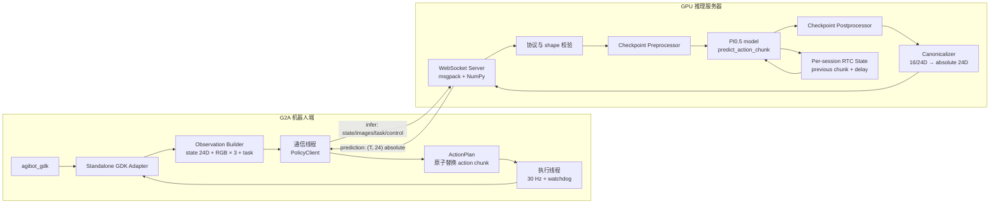
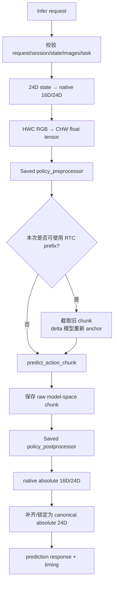
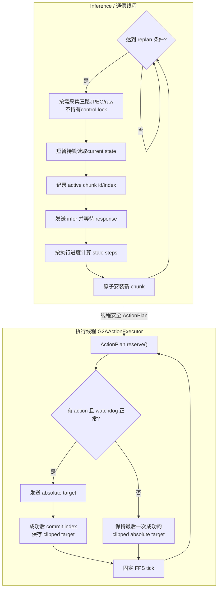
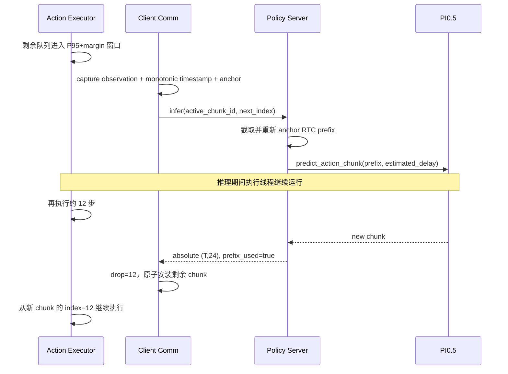

# G2A PI0.5 远程部署

## 最先看：当前 Nexus 启动入口

当前模型 Server 由 Nexus 工程的 `deploy.toml` 统一管理。在 GPU 服务器上：

```bash
cd /data/company/data_common/lxl/workspace/g2a_deploy_project

# 无界面启动 PI0.5 Server，端口 5557
./scripts/g2a-deploy server start pi05
./scripts/g2a-deploy server status pi05

# 有界面时按 Nexus 根目录 README 启动 control_api
```

推荐在 Nexus 任务页点击“开始观测”来启动 G2 Client。手工只读联调：

```bash
ssh g2
cd /home/agi/deploy/g2a_robot_client
pgrep -af 'python3? -m [r]obot_client'

./robot_client/run.sh \
  --host=10.42.1.200 \
  --port=5557 \
  --task="Pick a package from the box with the left gripper and place it on the table. Then pick it up with the right gripper and place it on the conveyor belt, keeping the QR code facing upward." \
  --inference-mode=async \
  --read-only \
  --duration-s=60
```

无线回退时把 `--host` 改为 `192.168.110.140`。未完成安全标定和低速验收时
不得把 `--read-only` 改成 `--execute`。更完整的 Client 说明见
[`robot_client/README.md`](robot_client/README.md)。

本目录提供一套面向 G2A 真机的 PI0.5 远程推理框架。GPU 服务器负责加载
LeRobot checkpoint、执行预处理/模型推理/后处理；机器人端负责通过 GDK
采集状态和图像、发送 observation、接收 action chunk，并以固定频率执行绝对
关节目标。

当前实现兼容以下三类 action 模型；16D absolute 和 16D delta 均提供 LoRA 与
full fine-tuning profile：

| Profile | 模型原生输入/输出 | 网络输出 |
|---|---|---|
| `24d_absolute` | 24D，absolute action | 24D absolute action |
| `16d_absolute` | 双臂 + 双夹爪 16D，absolute action（LoRA） | 补齐为 24D absolute action |
| `16d_absolute_full` | 双臂 + 双夹爪 16D，absolute action（full fine-tuning） | 补齐为 24D absolute action |
| `16d_absolute_full_aug` | 双臂 + 双夹爪 16D，absolute action（full fine-tuning + OpenPI 图像增强） | 补齐为 24D absolute action |
| `16d_delta` | 双臂为 delta、双夹爪为 absolute 的 16D 混合 action（LoRA） | 转换并补齐为 24D absolute action |
| `16d_delta_full` | 同一套 16D 混合 action（full fine-tuning） | 转换并补齐为 24D absolute action |

无论内部模型是不是 delta，客户端收到的 action 都是 24D 绝对位置。客户端
绝对不能再次执行 `action += state`。

> **安全提示：** 默认客户端是 `--dry-run`，不会连接 GDK。只有显式添加
> `--execute` 才会向真机发送指令。第一次真机验证必须先完成 mock 和
> `--read-only` 测试，并在低速、急停可用、机器人周围无人的条件下进行。

## 1. 目录结构

```text
src/nexus_deploy/vla/pi05/
├── README.md             # 本文档
├── server.py             # GPU 端 WebSocket policy server
├── robot_client/         # 推荐：可复制到机器人、无LeRobot依赖的独立client
├── protocol.py           # msgpack/NumPy 编解码和请求校验
├── policy.py             # 三类 action checkpoint 的统一推理适配和 RTC 状态
├── profiles.py           # 实验 profile 到本地 checkpoint 的映射
├── dataset_start_state.py # Nexus 标准起始姿态及历史兼容别名
└── requirements.txt      # WebSocket 与 msgpack 依赖
```

相关代码：

- G2A 硬件适配器：[src/lerobot/robots/g2a](../../src/lerobot/robots/g2a/)
- 部署服务端：[server.py](server.py)
- 真机独立客户端：[robot_client/](robot_client/)
- 模型适配层：[policy.py](policy.py)

## 2. 总体 pipeline



端到端数据流如下：

1. 独立 G2A adapter 从 GDK 读取24D当前关节位置；只在需要推理时采集三路
   JPEG/raw图像。头部JPEG保持原样，左右腕默认在机器人端缩放为`640×400`
   并重新编码为JPEG。
2. 客户端通信线程生成 observation，并附带当前 action chunk 的执行进度。
3. observation 通过WebSocket发送；机器人端使用内置的最小MessagePack codec，
   不依赖外部`msgpack`包。
4. server校验state、编码图像、task、session和控制字段，并把JPEG/raw统一解码为
   HWC uint8 RGB。
5. checkpoint 自带的 preprocessor 执行相机键重命名、batch、归一化、状态
   token 化、文本 token 化和 device 搬运。
6. PI0.5 产生一个 action chunk；RTC 模式下会把旧 chunk 未执行部分作为
   denoising prefix。
7. checkpoint 自带的 postprocessor 执行反归一化；delta 模型还会把内部
   delta action 恢复为 absolute action。
8. server 把 16D 或 24D 原生结果统一转换成 `(T, 24)` absolute action。
9. 客户端按实际推理耗时丢弃已经过时的前几步，再原子替换 action queue。
10. 独立执行线程以 30 Hz reserve action，GDK 完整发送成功后才 commit；
    断流时保持最后一次成功发送的 clipped absolute target。

## 3. 统一的数据契约

### 3.1 24D state/action 顺序

客户端到服务端的 state 和服务端到客户端的 action 始终使用下面的顺序。
表中的 index 为 Python 的 0-based index。

| Index | 名称 | 分组 |
|---:|---|---|
| 0 | `left_arm_joint1` | 左臂 |
| 1 | `left_arm_joint2` | 左臂 |
| 2 | `left_arm_joint3` | 左臂 |
| 3 | `left_arm_joint4` | 左臂 |
| 4 | `left_arm_joint5` | 左臂 |
| 5 | `left_arm_joint6` | 左臂 |
| 6 | `left_arm_joint7` | 左臂 |
| 7 | `left_effector_position` | 左夹爪 |
| 8 | `right_arm_joint1` | 右臂 |
| 9 | `right_arm_joint2` | 右臂 |
| 10 | `right_arm_joint3` | 右臂 |
| 11 | `right_arm_joint4` | 右臂 |
| 12 | `right_arm_joint5` | 右臂 |
| 13 | `right_arm_joint6` | 右臂 |
| 14 | `right_arm_joint7` | 右臂 |
| 15 | `right_effector_position` | 右夹爪 |
| 16 | `head_joint1` | 头部 |
| 17 | `head_joint2` | 头部 |
| 18 | `head_joint3` | 头部 |
| 19 | `waist_joint1` | 腰部 |
| 20 | `waist_joint2` | 腰部 |
| 21 | `waist_joint3` | 腰部 |
| 22 | `waist_joint4` | 腰部 |
| 23 | `waist_joint5` | 腰部 |

因此：

```python
arms_and_effectors = vector[:16]
head_and_waist = vector[16:24]
```

### 3.2 Nexus标准起始姿态

[dataset_start_state.py](dataset_start_state.py) 中的
`APPROVED_START_STATE_PROFILE_ID=g2_sorting_home_20260817_v1` 是模型warmup、Mock观测、
客户端启动检查和机器人身体复位共同使用的唯一运行时起始姿态。旧的数据集逐关节中位数已经
停用；`DATASET_START_STATE_*` 名称仅作为兼容别名并返回同一组新值：

```python
APPROVED_START_STATE_24D = (
     0.76465964, -0.31351972, -0.70621310, -1.36066850,
     0.46818197, -0.83775747, -0.17443806, -0.78357828,
    -0.76465964, -0.31351972,  0.70621310, -1.36066850,
    -0.46818197, -0.83775747,  0.17443806, -0.78500003,
     0.00000000,  0.00000000,  0.41756022, -0.55547464,
     0.81430656, -0.08542661,  0.01562496,  0.03201678,
)
```

16D模型使用上述向量的前16维。也可以按关节名读取，避免手工维护index：

```python
from nexus_deploy.vla.pi05.dataset_start_state import (
    get_approved_start_state,
    get_approved_start_state_by_joint,
)

reference_16d = get_approved_start_state(16)
reference_24d = get_approved_start_state(24)
reference_by_joint = get_approved_start_state_by_joint()
```

这组值是统一参考，不代表可以绕过安全机制直接下发：

- 身体复位仍必须经过最大行程、速度、反馈、GDK独占和平台人工确认。
- 正常client启动不会自动移动到此姿态，也不会用这些值裁剪模型action。
- 只有平台确认后的身体复位入口会把它作为真机目标；夹爪始终跳过。

### 3.3 图像和 task

服务端严格要求三路图像，键名和格式为：

```python
images = {
    "cam_head": np.ndarray,         # HWC, uint8, RGB
    "cam_left_wrist": np.ndarray,   # HWC, uint8, RGB
    "cam_right_wrist": np.ndarray,  # HWC, uint8, RGB
}
```

checkpoint preprocessor 会把它们重命名成训练时使用的 policy feature：

```text
cam_head        → observation.images.base_0_rgb
cam_left_wrist  → observation.images.left_wrist_0_rgb
cam_right_wrist → observation.images.right_wrist_0_rgb
```

`task` 必须是字符串。部署时应优先使用训练数据中实际出现的 task 文本，避免只
因为示例命令中的英文 prompt 与训练 prompt 不一致而引入分布偏移。

独立client不会再使用旧的`320×240`尺寸。头部相机保持GDK原始`640×400`；左右腕
从GDK的`1280×1056`直接缩放到训练数据使用的`640×400`后重新JPEG编码。机器人端
使用已有Pillow，不依赖当前ABI不兼容的OpenCV。server解码后，PI0.5模型仍负责最终
resize/pad。可用`--no-resize-wrist-images`运行原始分辨率对照。

## 4. 三种模型的推理适配

### 4.1 24D absolute

```text
24D current state
    ↓ checkpoint preprocessor + normalization
PI0.5 predicts normalized absolute 24D chunk
    ↓ checkpoint postprocessor + unnormalize
absolute 24D chunk
    ↓ 默认覆盖 action[:, 16:24] = current_state[16:24]
network returns absolute 24D chunk
```

头部和腰部默认被锁定为每次 observation 中的当前测量值。训练数据中这 8 个
自由度基本静止，所以首轮真机实验不建议添加 `--command-head-waist`。只有确认
模型在这部分有有效训练信号并完成安全检查后，才允许 24D 模型直接控制它们。

### 4.2 16D absolute

```text
24D current state
    ↓ select state[:16]
16D state
    ↓ checkpoint preprocessor/model/postprocessor
absolute 16D chunk
    ↓ append current_state[16:24] to every step
network returns absolute 24D chunk
```

模型只预测双臂和夹爪。头部/腰部不经过模型，始终使用当前测量位置填充。

### 4.3 16D delta

LoRA 和 full fine-tuning delta checkpoint 都是“手臂 delta + 夹爪 absolute”的混合 action：

```text
24D current state
    ↓ select state[:16]
16D state
    ↓ preprocessor caches current state and normalizes
PI0.5 predicts normalized 16D mixed-action chunk
    ↓ unnormalize
14 arm dimensions: delta
2 effector dimensions: absolute
    ↓ AbsoluteActions postprocessor
absolute 16D chunk
    ↓ append current_state[16:24]
network returns absolute 24D chunk
```

换句话说，delta 只存在于服务端 checkpoint 的内部处理过程中。客户端、网络
协议和 G2A adapter 全部只处理 absolute action。

## 5. 服务端 pipeline

### 5.1 启动和模型加载

服务端启动时按以下顺序工作：

1. 根据 `--model-profile` 找到对应输出目录。
2. 遍历 `checkpoints/<step>/pretrained_model`。
3. 只接受包含配置、processor 和模型/LoRA 权重的完整 checkpoint。
4. 选择数字 step 最大的完整 checkpoint，并用 WARNING 打印 profile 和最终绝对路径；
   `--checkpoint` 可覆盖该选择。
5. 以 `local_files_only=True` 加载 config、PI0.5 base model 和 LoRA adapter。
6. 从同一个 checkpoint 加载 preprocessor 和 postprocessor。
7. 把模型移动到 `--device`、切换到 `eval()`，然后开始监听端口。

LoRA checkpoint 的 `adapter_config.json` 中
`base_model_name_or_path` 必须指向服务器上可访问的本地 base model。文本
tokenizer 路径则来自 `policy_preprocessor.json`。

### 5.2 单请求推理



GPU 推理被放在单独且串行的 worker 中，不阻塞 WebSocket event loop。当前
server 只允许一个机器人连接，同时只进行一个模型推理，避免同一个 policy 和
processor 的状态被多个 session 并发修改。

### 5.3 metadata handshake

WebSocket 连接建立后，服务端首先主动发送 metadata，包含：

- 协议名称和版本；
- 实际 checkpoint 路径和模型 profile；
- native action 维度、canonical action 维度和关节名称；
- `action_space="absolute"`；
- chunk size、FPS 和相机键；
- 头部/腰部是否锁定；
- checkpoint 内部是否使用 relative action；
- RTC 是否可用及其参数。

客户端会在发送第一帧前校验 metadata。维度、相机顺序、action space、FPS 或
RTC capability 不一致时会直接退出，不会进入真机执行。

## 6. 客户端 pipeline

独立客户端包含两个工作线程。相机采集与GDK Robot的state/action控制通道分开：



关键行为：

- inference线程只在达到replan条件时调用GDK `Camera`采集三路编码图像，不再
  持续维护latest-frame buffer。
- 相机调用不持有`control_lock`；state读取和action发送共享这个短时锁，因此
  相机阻塞不会阻塞30Hz action发送。
- JPEG/raw解码和RGB转换全部位于server，机器人端不依赖OpenCV。
- 相机采集失败会跳过本次推理并重试，不会推进action plan。
- 当前记录的是host侧每路帧完成时间；GDK adapter尚未获得设备侧曝光时间戳。
- 通信线程推理时，action 线程仍能继续执行旧 chunk。
- 每个连接只允许一个推理请求处于 in-flight 状态。
- 收到新 chunk 时会计算推理期间已经执行了多少步，并跳过对应前缀。
- action 在发送前只会被 reserve；body 和两侧夹爪全部发送成功后才推进
  `next_action_index`。新 chunk 安装会等待 in-flight action 完成。
- 如果整段新 chunk 都已经过时，响应会被丢弃；下一次请求会 reset 服务端的
  session 推理状态。
- action queue 暂时为空时保持 GDK 最后一次成功返回的 clipped absolute target，
  不保存或重复发送未经限幅的模型原始 action。
- 超过 `--watchdog-timeout-s` 没有收到有效响应时清空 queue，并保持最后目标。
- 网络断开后客户端会尝试重连；重连成功会清空旧计划并创建新 session。
- 当前选定的 action 发送失败策略是只打印 WARNING 并停止 action 执行线程；
  通信线程和主进程不会因此自动退出或重连。此行为便于定位故障，但不等同于
  fail-safe，真机操作员必须监控日志并保留硬件急停。

## 7. sync、async 和 RTC

| 模式 | 何时请求新 chunk | 推理期间是否继续执行旧 chunk | 模型是否使用旧 chunk prefix | 适用场景 |
|---|---|---:|---:|---|
| `sync` | 当前 chunk 全部执行完 | 否，保持最后目标 | 否 | 最简单的功能验证、测量原始推理停顿 |
| `async` | 剩余队列进入 rolling P95 延迟窗口后 | 是 | 否 | 验证异步调度本身的收益 |
| `rtc` | 剩余队列进入 rolling P95 延迟窗口后 | 是 | 是 | 降低连续重规划时 action chunk 的跳变 |

`rtc` 不是把两段 absolute action 做简单加权平均。它是模型侧的
real-time chunking：

1. server 保存上一个 chunk 的 raw model-space action。
2. client 在新 observation 中报告旧 chunk ID 和下一个待执行 index。
3. server 取出仍未执行的 prefix。
4. 对 delta 模型，先从旧的 absolute action 重新以当前 state 为 anchor，再
   归一化回模型空间。
5. prefix 最多裁剪到 `execution-horizon`；短 prefix 保持实际长度且绝不在 Server 端补零，
   并连同预计延迟传给 PI0.5 的
   denoising 过程。
6. 新 chunk 返回后，client 用 observation 的单调时钟时间计算 stale steps，只安装
   `actions[stale_steps:quality_horizon]`。
7. async 使用 rolling P95 延迟步数加3步余量触发请求；RTC 的提前量还保证不小于
   `execution-horizon`，并要求预计及实际有效融合区间至少8步。传输层同一时间只允许一个
   请求在途。

完整时间轴、参数、prefix不足处理和安全降级规则见 [ASYNC_RTC.md](ASYNC_RTC.md)。

典型的 RTC 时序如下：



例如推理 RTT 为 `0.4 s`、控制频率为 `30 Hz`，日志中出现约 `drop=12` 是符合
预期的。第一个 chunk 没有历史 prefix，因此第一次
`rtc_prefix=False` 也是正常现象。

## 8. 网络协议

协议采用 OpenPI 风格的 WebSocket request/response，但字段针对 G2A 做了固定
约束：

- 传输：WebSocket binary frame；
- 序列化：msgpack；
- 数组：显式记录 NumPy dtype、shape 和原始 bytes；
- 禁用 pickle；
- 默认单条消息上限：64 MiB；
- WebSocket compression 关闭；
- 当前协议：`nexus-policy-websocket` version `2`；迁移期兼容
  `g2a-policy-websocket` version `2` 和历史 `g2a-pi05-websocket` version `1`。

### 8.1 infer request 示例

下面是解码后的逻辑结构；实际图像和数组以 msgpack 二进制编码：

```python
request = {
    "kind": "infer",
    "request_id": "session-id-00000001",
    "session_id": "session-id",
    "reset": True,
    "observation": {
        "state": np.zeros((24,), dtype=np.float32),
        "images": {
            "cam_head": np.zeros((400, 640, 3), dtype=np.uint8),
            "cam_left_wrist": np.zeros((400, 640, 3), dtype=np.uint8),
            "cam_right_wrist": np.zeros((400, 640, 3), dtype=np.uint8),
        },
        "task": "Pick a package from the box with the left gripper and place it on the table. Then pick it up with the right gripper and place it on the conveyor belt, keeping the QR code facing upward.",
        "state_capture_wall_time_ns": 1780000000010000000,
        "camera_capture_start_wall_time_ns": 1779999999990000000,
        "camera_capture_wall_time_ns": 1780000000000000000,
        "camera_capture_duration_ms": 10.0,
        "camera_frame_wall_time_ns": {
            "cam_head": 1779999999994000000,
            "cam_left_wrist": 1779999999997000000,
            "cam_right_wrist": 1780000000000000000,
        },
        "camera_age_ms": 10.0,
        "camera_skew_ms": 6.0,
        "state_camera_skew_ms": 10.0,
    },
    "control": {
        "mode": "rtc",
        "enable_rtc": True,
        "active_chunk_id": "session-id:1",
        "next_action_index": 15,
        "estimated_delay_steps": 12,
    },
}
```

### 8.2 prediction response 示例

```python
response = {
    "status": "ok",
    "kind": "prediction",
    "request_id": "session-id-00000001",
    "session_id": "session-id",
    "chunk_id": "session-id:2",
    "actions": np.zeros((50, 24), dtype=np.float32),
    "action_space": "absolute",
    "action_dim": 24,
    "rtc": {
        "prefix_used": True,
        "estimated_delay_steps": 12,
    },
    "server_timing": {
        "preprocess_ms": 8.0,
        "infer_ms": 365.0,
        "postprocess_ms": 2.0,
        "total_ms": 375.0,
    },
}
```

服务端还支持 `ping`、`reset` 两种请求。通常无需手工构造消息，直接使用机器人
独立部署包内的 `PolicyClient` 即可。

## 9. 环境准备

从仓库根目录开始：

```bash
cd /path/to/nexus_deploy
```

GPU server 使用已有的 `lerobot` conda 环境：

```bash
conda run -n lerobot \
  python -m pip install -r pyproject.toml 和 uv.lock
```

确认 PyTorch 和 GPU：

```bash
conda run -n lerobot python -c \
  "import torch; print(torch.cuda.is_available()); print(torch.cuda.get_device_name(0))"
```

机器人电脑也需要安装 `requirements.txt` 中的依赖，并需要厂商提供的
`agibot_gdk`。GPU server 不需要 GDK；`--dry-run` 也不需要 GDK。

## 10. 模型 profile 和 checkpoint

默认 profile 映射定义在 [profiles.py](profiles.py)：

| Profile | 输出目录 |
|---|---|
| `24d_absolute` | `outputs/g2a_pi05_lora_r16_30k` |
| `16d_absolute` | `outputs/g2a_pi05_16d_absolute_lora_r16_30k` |
| `16d_absolute_full` | `outputs/g2a_pi05_16d_absolute_full_30k` |
| `16d_delta` | `outputs/g2a_pi05_16d_armdelta_lora_r16_30k` |
| `16d_delta_full` | `outputs/g2a_pi05_16d_armdelta_full_30k` |

服务端会从对应目录的 `checkpoints/` 下选择 step 最大且完整的
`pretrained_model`。完整 checkpoint 至少应包含：

```text
config.json
policy_preprocessor.json
policy_postprocessor.json
model.safetensors
```

LoRA checkpoint 则用下面两个文件代替 `model.safetensors`：

```text
adapter_config.json
adapter_model.safetensors
```

使用 `--checkpoint` 可以绕过 profile 的自动选择：

```bash
conda run --no-capture-output -n lerobot \
  python -m nexus_deploy.vla.pi05.server \
  --model-profile=16d_absolute \
  --checkpoint=/absolute/path/to/checkpoints/016000/pretrained_model \
  --device=cuda:0 \
  --host=0.0.0.0 \
  --port=5556
```

`--checkpoint` 的模型维度和 delta 配置会从 checkpoint 本身推断，
`--model-profile` 此时只满足命令行参数要求，不会覆盖 checkpoint 内部配置。

一个 server 进程只加载一个模型。切换 profile 时需要停止并重启 server。

## 11. 快速验证：完全 mock

mock 不加载 GPU 模型、不连接 GDK，输出保持当前位置的 absolute action，适合
先验证协议、线程、RTC 和日志。

终端 1：

```bash
cd /path/to/nexus_deploy

conda run --no-capture-output -n lerobot \
  python -m nexus_deploy.vla.pi05.server \
  --mock \
  --mock-inference-delay-s=0.4 \
  --host=127.0.0.1 \
  --port=18082
```

终端 2：

```bash
cd /path/to/nexus_deploy

conda run --no-capture-output -n lerobot \
  python -m nexus_deploy.robot.g2a \
  --host=127.0.0.1 \
  --port=18082 \
  --inference-mode=rtc \
  --dry-run \
  --duration-s=10
```

预期结果：

- 第一个 chunk 显示 `rtc_prefix=False`；
- 后续 chunk 显示 `rtc_prefix=True`；
- 在 30 Hz 和 0.4 秒延迟下，`drop` 通常约为 12；
- client 和 server 都会自动在 `outputs/g2a_pi05_deploy/logs/` 保存日志。

检查 health endpoint：

```bash
curl http://127.0.0.1:18082/healthz
```

预期返回：

```text
OK
```

## 12. 启动真实模型 server

只关注真机实际执行时，可以直接查看精简版
[REAL_ROBOT_RUN.md](REAL_ROBOT_RUN.md)。

以下命令均在 GPU server 上运行。

### 12.1 24D absolute

```bash
cd /path/to/nexus_deploy

conda run --no-capture-output -n lerobot \
  python -m nexus_deploy.vla.pi05.server \
  --model-profile=24d_absolute \
  --device=cuda:0 \
  --host=0.0.0.0 \
  --port=5556
```

该命令默认锁定头部/腰部。初次测评不要添加
`--command-head-waist`。

### 12.2 16D absolute

LoRA：

```bash
conda run --no-capture-output -n lerobot \
  python -m nexus_deploy.vla.pi05.server \
  --model-profile=16d_absolute \
  --device=cuda:0 \
  --host=0.0.0.0 \
  --port=5556
```

### 12.3 16D absolute full fine-tuning

```bash
conda run --no-capture-output -n lerobot \
  python -m nexus_deploy.vla.pi05.server \
  --model-profile=16d_absolute_full \
  --device=cuda:0 \
  --host=0.0.0.0 \
  --port=5556
```

该 profile 自动选择
`outputs/g2a_pi05_16d_absolute_full_30k/checkpoints/` 下 step 最大且完整的
checkpoint。

### 12.4 16D delta

LoRA 普通 async 基线：

```bash
conda run --no-capture-output -n lerobot \
  python -m nexus_deploy.vla.pi05.server \
  --model-profile=16d_delta \
  --device=cuda:0 \
  --host=0.0.0.0 \
  --port=5556
```

Server 始终初始化 RTC 能力。做 RTC 测试不需要重启或修改 Server，只需把 Client
设为 `--inference-mode=rtc`。使用 `async` 时 Client 不发送 RTC prefix，模型按普通
action chunk 推理。

### 12.5 16D delta full fine-tuning

```bash
conda run --no-capture-output -n lerobot \
  python -m nexus_deploy.vla.pi05.server \
  --model-profile=16d_delta_full \
  --device=cuda:0 \
  --host=0.0.0.0 \
  --port=5556
```

该 profile 自动选择
`outputs/g2a_pi05_16d_armdelta_full_30k/checkpoints/` 下 step 最大且完整的
checkpoint。是否使用 RTC 同样只由 Client 的 `--inference-mode` 决定。

`--device=cuda:0` 指当前进程可见 GPU 中的第 0 张卡。如果外部设置了
`CUDA_VISIBLE_DEVICES`，设备序号会被重新编号。

服务端只有在模型加载完成后才开始监听端口。首次加载 PI0.5/LoRA 期间客户端
显示 `Waiting for policy server` 属于正常现象。

## 13. 客户端运行示例

以下命令在机器人电脑解压出的`g2a_pi05_robot_client`目录运行，把
`<GPU_SERVER_IP>`替换为真实地址。先执行`source ~/app/env.sh`。

### 13.1 dry-run：不连接 GDK

```bash
./robot_client/run.sh \
  --host=<GPU_SERVER_IP> \
  --port=5556 \
  --inference-mode=async \
  --dry-run \
  --duration-s=30 \
  --task="Pick a package from the box with the left gripper and place it on the table. Then pick it up with the right gripper and place it on the conveyor belt, keeping the QR code facing upward."
```

### 13.2 read-only：真实 observation，不发送 action

这是正式真机测试前必须完成的一步：

```bash
./robot_client/run.sh \
  --host=<GPU_SERVER_IP> \
  --port=5556 \
  --inference-mode=rtc \
  --read-only \
  --duration-s=60 \
  --fps=30 \
  --servo-fps=100 \
  --task="Pick a package from the box with the left gripper and place it on the table. Then pick it up with the right gripper and place it on the conveyor belt, keeping the QR code facing upward."
```

该示例使用 RTC。Server 始终具备 RTC 能力，不需要增加额外开关；改成
`--inference-mode=async` 即使用普通异步推理。

如果 GDK 无法自动识别末端执行器，可按实际硬件补充：

```text
--left-effector-type=<TYPE> --right-effector-type=<TYPE>
```

### 13.3 只读模型输出诊断

固定第一次采集的OBS，检查模型面对完全相同输入时是否产生不一致或高频换向：

```bash
./robot_client/run.sh \
  --host=<GPU_SERVER_IP> \
  --port=5556 \
  --inference-mode=async \
  --read-only \
  --duration-s=20 \
  --fps=30 \
  --servo-fps=100 \
  --min-replan-after-steps=1 \
  --action-trace-dir=./logs/action_traces \
  --freeze-trace-observation \
  --task="Pick a package from the box with the left gripper and place it on the table. Then pick it up with the right gripper and place it on the conveyor belt, keeping the QR code facing upward."
```

`--action-trace-dir`只能和`--read-only`同时使用。原始30Hz action chunk、24D
state、三路图像、prompt、时延和仅供观察的100Hz插值轨迹都会保存。把trace
复制回本机后运行：

```bash
conda run --no-capture-output -n lerobot \
  .venv/bin/python tools/pi05/analyze_action_trace.py <TRACE_DIR>
```

报告和逐请求、逐关节图片生成在`<TRACE_DIR>/analysis/`。去掉
`--freeze-trace-observation`可再做一组实时OBS对照。

若需要隔离PI0.5 flow-matching初始noise带来的跨请求随机性，可在server上增加：

```text
--fixed-noise-seed=123
```

该参数只用于诊断或经过真机验证后的确定性部署实验。默认值仍是`None`，即每次
推理重新采样高斯noise。固定seed不会平滑单个chunk内部的轨迹，只会让相同OBS
对应相同的初始noise和输出；不能仅凭离线平滑指标直接用于真机。

### 13.4 execute：真机执行

```bash
./robot_client/run.sh \
  --host=<GPU_SERVER_IP> \
  --port=5556 \
  --inference-mode=rtc \
  --execute \
  --fps=30 \
  --servo-fps=100 \
  --min-replan-after-steps=1 \
  --watchdog-timeout-s=3.0 \
  --max-relative-target=0.05 \
  --max-gripper-relative-target=0.05 \
  --relative-target-mode=warn \
  --task="Pick a package from the box with the left gripper and place it on the table. Then pick it up with the right gripper and place it on the conveyor belt, keeping the QR code facing upward."
```

`Ctrl-C` 会停止客户端。`--duration-s=0` 表示持续运行；可在初次测试中设置
`--duration-s=10`，让程序自动停止。

这里的两个 `max-*-relative-target` 是“相邻100Hz GDK目标变化量”的 WARNING 阈值。
部署默认 `--relative-target-mode=warn`，超过阈值只打印告警，不裁剪相对变化；
网络输出仍然是 absolute action。夹爪物理绝对范围 `[-0.785, 0]` 仍会强制裁剪。
如果显式改为 `--relative-target-mode=clip`，两个阈值才会恢复为相对限幅。

`--fps=30`是policy/data/RTC的时间基准，不能改成100；独立的
`--servo-fps=100`负责把30Hz action chunk按时间线性插值后固定100Hz发送到
GDK，并把`JointServoControlReq.control_period`设置为10ms。

### 13.5 后台运行

如确实需要关闭终端后继续运行，可使用 `nohup`，并保留显式日志路径：

```bash
mkdir -p outputs/g2a_pi05_deploy/logs

nohup conda run --no-capture-output -n lerobot \
  python -m nexus_deploy.vla.pi05.server \
  --model-profile=16d_delta \
  --device=cuda:0 \
  --host=0.0.0.0 \
  --port=5556 \
  --log-file=outputs/g2a_pi05_deploy/logs/server_16d_delta_rtc.log \
  > outputs/g2a_pi05_deploy/logs/server_16d_delta_rtc.console.log 2>&1 &
```

真机 client 不建议在无人监控时后台执行。后台方式更适合 GPU server。

## 14. 建议的三模型对比矩阵

为了区分“动作表示”“自由度”和“调度方式”的影响，建议固定 task、episode
初始状态、相机分辨率、FPS 和安全参数，只改变下面的变量：

| 实验 | Server profile | Client RTC request | Client mode | 目的 |
|---|---|---:|---|---|
| A | `24d_absolute` | 关 | `sync` | 24D 基础结果 |
| B | `16d_absolute` | 关 | `sync` | 只比较 24D/16D |
| C | `16d_delta` | 关 | `sync` | 只比较 absolute/delta |
| D | `16d_delta` | 关 | `async` | 测量异步调度收益 |
| E | `16d_delta` | 开 | `rtc` | 测量 RTC 连续性收益 |

如果还要验证 RTC 对 absolute 模型的影响，可以在 `16d_absolute` 上增加
`async` 和 `rtc` 两组。不要用不同 task prompt、不同图像分辨率或不同
rolling P95 窗口和 horizon 参数直接比较模型，否则实验变量会混在一起。

建议至少记录：

- task 成功率；
- 完成时间；
- 相对目标阈值 WARNING 和夹爪物理范围裁剪次数；
- 夹取成功率和掉落次数；
- client RTT、server inference latency；
- `drop`、queue underrun 和 watchdog 次数；
- 相邻 absolute action 的变化量或 jerk；
- RTC `prefix_used` 比例。

## 15. 参数建议

| 参数 | 当前默认/建议起点 | 说明 |
|---|---:|---|
| `--fps` | `30` | policy/data/RTC频率，必须与server一致 |
| `--servo-fps` | `100` | 机器人GDK固定下发频率；独立于policy频率 |
| `--prediction-horizon` | `50` | 必须与模型返回 chunk 长度一致 |
| `--quality-horizon` | `50` | 当前可信 action 范围；延迟低于约0.5秒后再比较35 |
| `--min-replan-after-steps` | `1` | 新包安装后允许再次请求前至少执行的步数 |
| `--request-lead-margin-steps` | `8` | rolling P95 延迟以外的请求安全余量；覆盖偶发延迟峰值 |
| `--latency-window-size` | `20` | rolling P95 使用的最近请求数 |
| `--execution-horizon` | `30` | RTC prefix 长度；server 和 metadata 的来源 |
| `--watchdog-timeout-s` | `3.0` | 超时后清空 queue 并保持最后目标 |
| `--request-timeout-s` | `30` | 单次 WebSocket inference 等待上限 |
| `--camera-timeout-ms` | `1000` | 每路GDK相机调用的超时 |
| `--max-message-mb` | `64` | JPEG/raw编码图像及协议消息的大小上限 |
| `--max-relative-target` | `0.05` | 手臂相邻绝对目标的 WARNING 阈值 |
| `--max-gripper-relative-target` | `0.05` | 夹爪相邻绝对目标的 WARNING 阈值 |
| `--relative-target-mode` | `warn` | 超阈值只告警、不裁剪；设为 `clip` 才启用相对限幅 |
| `--initial-head-waist-warning-threshold` | `0.01` | 24D模型启动时头腰偏离零位的告警阈值；不阻止执行 |
| `--max-guidance-weight` | `10.0` | RTC prefix guidance 最大权重 |
| `--prefix-attention-schedule` | `EXP` | 可选 `ZEROS/ONES/LINEAR/EXP` |

如果 `infer_ms` 的 P95 接近 350–400 ms，30 Hz 下会跨过约 11–12 个控制步。
当前使用 rolling P95 延迟和 3 步余量自适应触发请求，不再固定执行 15 步。如果网络和推理延迟进一步增大，应先
定位带宽/模型性能，而不是盲目把 replan 提得很晚；否则留给下一次推理的旧
chunk 会变短，更容易出现 queue underrun。

三路图像不会按相机采集帧率持续发送，只在自适应调度触发推理请求时发送。实际请求
频率取决于 rolling P95 延迟、可信 horizon 和 3 步余量；正式部署建议使用稳定的有线局域网。

## 16. 日志

未指定 `--log-file` 时，日志自动保存到：

```text
outputs/g2a_pi05_deploy/logs/
├── server_YYYYMMDD_HHMMSS.log
└── client_YYYYMMDD_HHMMSS.log
```

客户端安装 chunk 的典型日志：

```text
Installed chunk=<session>:2 request=<request> drop=12 rtt=401.2ms infer=366.8ms rtc_prefix=True
```

字段解释：

- `chunk`：服务端 session 内递增的 action chunk ID；
- `request`：客户端唯一请求 ID；
- `drop`：从新 chunk 开头跳过的过时 action 数；
- `rtt`：客户端观测到的完整请求往返时间；
- `infer`：服务端单独统计的模型推理时间；
- `rtc_prefix`：这一次 PI0.5 是否实际使用了旧 chunk prefix。

查看最新 client 日志：

```bash
tail -f "$(find outputs/g2a_pi05_deploy/logs -name 'client_*.log' -printf '%T@ %p\n' \
  | sort -n | tail -n 1 | cut -d' ' -f2-)"
```

查看指定 server 日志：

```bash
tail -f outputs/g2a_pi05_deploy/logs/server_16d_delta_rtc.log
```

## 17. 测试

运行本目录单元测试：

```bash
conda run --no-capture-output -n lerobot \
  pytest -q tests/scripts/test_g2a_pi05_deploy.py
```

静态检查：

```bash
conda run --no-capture-output -n lerobot \
  ruff check src/nexus_deploy/vla/pi05 tests/scripts/test_g2a_pi05_deploy.py
```

推荐的上线顺序：

1. `mock server + dry-run client`，无延迟；
2. `mock server + dry-run client`，加入 0.4 秒延迟；
3. 真实模型 server + dry-run client；
4. 真实模型 server + read-only client；
5. 检查 state 顺序、三路画面、action 数值、RTT 和日志；
6. 急停可用且人工监控时，短时间 `--execute --duration-s=10`；
7. 再逐步延长 episode，并依次完成三种模型的可控变量对比。

## 18. 故障排查

### 客户端一直显示 `Waiting for policy server`

- 确认 server 已完成模型加载；server 是加载完成后才监听端口。
- 检查 IP、端口和防火墙。
- 在 server 上运行 `curl http://127.0.0.1:5556/healthz`。
- 检查 server 日志是否因 checkpoint、本地 base model、PaliGemma 路径或
  CUDA OOM 退出。

### 第一次 `rtc_prefix=False`

正常。第一次推理没有旧 chunk。若后续一直为 false，检查是否频繁断线、响应被
丢弃、session 是否不断 reset，以及 `active_chunk_id` 是否仍与 server 保存的
chunk 匹配。

### `drop` 很大或 response 被判定为 stale

- 比较 `rtt` 与 `infer`：差值很大通常表示网络/序列化耗时高。
- 使用有线网络，确认没有跨公网传输三路未压缩 RGB。
- 临时用 `320×240` 判断问题是否来自图像带宽。
- 检查 GPU 是否同时运行训练任务。
- 如果 `drop >= chunk_size`，整段响应已经过时，客户端会拒绝安装。

### state/action 维度错误

网络边界固定是 24D。16D 只属于服务端内部模型维度。不要把 16D state 直接
发送给 server，也不要修改 client 让它接收 16D action。

### 图像键或格式错误

必须恰好包含 `cam_head`、`cam_left_wrist`、`cam_right_wrist`，且每张图都是
HWC、`uint8`、RGB。缺失键和额外键都会被拒绝。

### GDK 或末端执行器识别失败

- `--dry-run` 不需要 GDK，先用它确认 server/client 正常。
- `--read-only` 和 `--execute` 必须在安装了 `agibot_gdk` 的机器人电脑运行。
- 必要时显式设置 `--left-effector-type` 和 `--right-effector-type`。
- 检查 G2A adapter 日志中的关节缺失、相机超时和 effector range。

### CUDA 不可用或 OOM

```bash
conda run -n lerobot python -c \
  "import torch; print(torch.cuda.is_available(), torch.cuda.device_count(), torch.version.cuda)"
```

确认没有误用 `.venv`，且命令确实通过 conda 的 `lerobot` 环境运行。OOM 时先
检查同卡训练进程和 `--device`，不要通过降低协议 action 维度规避显存问题。

### 头部或腰部发生意外目标变化

- 确认 server 未添加 `--command-head-waist`。
- 检查 metadata 中 `head_waist_locked=true`。
- 16D 模型必然锁定头腰；24D 模型默认也锁定。
- 验证 client/state 中 `[16:24]` 的顺序和读数是否正确。

## 19. 当前约束与安全边界

- 一个 server 同时只允许一个机器人 WebSocket 连接。
- 每个客户端最多一个 inference request in flight。
- 切换 checkpoint 必须重启 server。
- server 保存 per-session RTC 状态，重连后会创建新 session，不能复用旧
  chunk。
- 协议目前没有身份认证、访问控制和 TLS。
- `--host=0.0.0.0` 只能用于受信任的机器人局域网；跨不可信网络时应通过
  VPN、SSH tunnel 或带 TLS/认证的反向代理。
- action queue 断流和 watchdog 只会保持最后一个绝对位置目标，它不能替代
  机器人控制器的硬件限位、碰撞检测和急停。
- action 发送异常当前只会记录 WARNING 并退出 action 线程，不会自动关闭整个
  client；这是已选定的诊断行为，不是安全停机机制。
- 当前部署默认对 `0.05` 相对阈值只告警、不裁剪；它不是硬件安全保证。
  真机部署仍必须依赖底层控制器限位、碰撞保护和人工急停。夹爪绝对范围
  `[-0.785, 0]` 仍由 adapter 强制执行。
